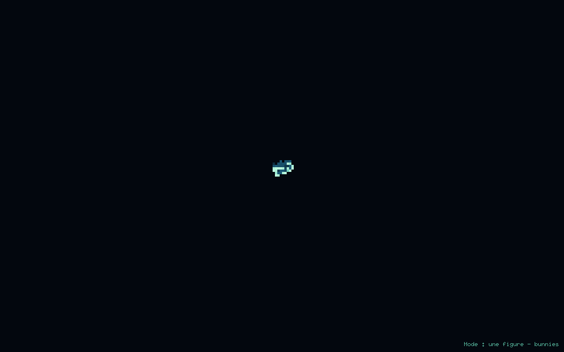
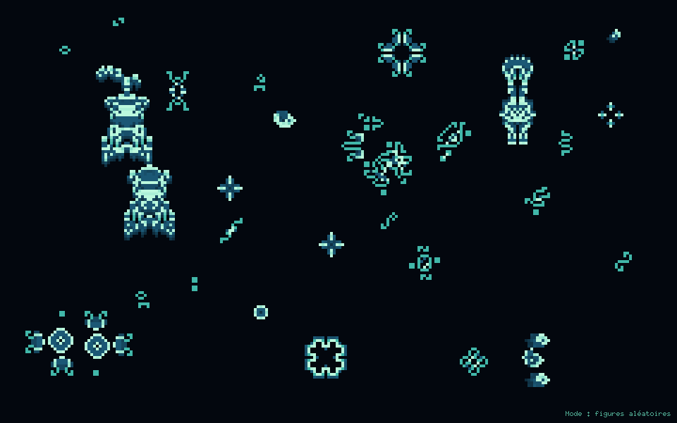

# Bibliothèque de figures

Les 810 motifs sont intégrés au binaire. Afficher leurs noms avec
`./game_of_life --list-figures`, puis lancer par exemple :

```sh
./game_of_life --figure pulsar
./game_of_life --figure koks-galaxy
./game_of_life --figure copperhead
./game_of_life --figure twin-bees-shuttle
./game_of_life --figure simkin-glider-gun --size 6
./game_of_life --figure pufferfish --size 8
./game_of_life --figure lidka --size 4 --seconds 600
./game_of_life --figure glider --size 24
./game_of_life --figure gosper-glider-gun --size 8
./game_of_life --figure acorn --size 4 --seconds 600
```

Chaque figure démarre à sa génération zéro, centrée dans une grille vide.
La simulation suit ensuite les règles habituelles : une figure peut produire
d’autres structures, notamment les gliders émis par le canon. Les bords bouclent ;
les vaisseaux peuvent donc revenir et interagir avec leur point de départ.
Le zoom automatique laisse de l’espace pour l’évolution, particulièrement aux
canons et aux graines expansives. `--size` permet de choisir un autre zoom.
Le renouvellement relance la même figure après une durée adaptée à sa famille
et à son activité ; `--seconds N` impose une durée fixe. Une figure entièrement
éteinte pendant deux secondes est relancée plus tôt.




## Étendue du catalogue

Le catalogue couvre **810 motifs compacts** de la collection LifeWiki présente
sur [copy.sh](https://copy.sh/life/examples/), parmi ses 1 830 fichiers RLE.
La sélection conserve les règles **B3/S23**, au plus **128 × 128 cellules** et
**512 cellules vivantes** au départ. Elle écarte les recettes de synthèse,
les collections, les démonstrations identifiées et les doublons initiaux par
rotation ou réflexion. Les 50 noms de la première bibliothèque sont conservés.

Ce n’est pas la totalité des constructions possibles, ni un catalogue de toutes
les découvertes récentes : c’est une collection figée, adaptée à ce screensaver.
Les catégories des motifs périodiques sont vérifiées par simulation ; les
canons, puffers, râteaux et graines reprennent leur famille documentée dans la
source. Les autres formes sont regroupées comme motifs évolutifs, sans leur
attribuer une période non vérifiée. Certaines s’éteignent rapidement.

Les dimensions et populations désignent la phase initiale intégrée. Les liens
sur les noms donnent le fichier RLE source. L’orientation ou la phase des
50 motifs historiques peut différer de celle du fichier source actuel.
Tous les motifs sont vérifiés dans leurs huit symétries, puis pendant seize
générations face à une simulation indépendante. Pour les 625 motifs
périodiques, les tests vérifient aussi le cycle complet et le déplacement.

### Structures stables — 148

| Nom à passer à `--figure` | Dimensions | Cellules | Évolution |
| --- | --- | ---: | --- |
| [`aircraft-carrier`](https://copy.sh/life/examples/aircraftcarrier.rle) | 4 × 3 | 6 | Stable |
| [`alternate-eater-5`](https://copy.sh/life/examples/alternateeater5.rle) | 10 × 6 | 17 | Stable |
| [`amphisbaena`](https://copy.sh/life/examples/amphisbaena.rle) | 7 × 5 | 11 | Stable |
| [`bakery`](https://copy.sh/life/examples/bakery.rle) | 10 × 10 | 28 | Stable |
| [`barge`](https://copy.sh/life/examples/barge.rle) | 4 × 4 | 6 | Stable |
| [`bee-hat`](https://copy.sh/life/examples/beehat.rle) | 6 × 6 | 15 | Stable |
| [`beehive`](https://copy.sh/life/examples/beehive.rle) | 4 × 3 | 6 | Stable |
| [`beehive-and-cap`](https://copy.sh/life/examples/beehiveandcap.rle) | 5 × 7 | 14 | Stable |
| [`beehive-and-dock`](https://copy.sh/life/examples/beehiveanddock.rle) | 6 × 7 | 16 | Stable |
| [`beehive-and-table`](https://copy.sh/life/examples/beehiveandtable.rle) | 5 × 6 | 12 | Stable |
| [`beehive-at-beehive`](https://copy.sh/life/examples/beehiveatbeehive.rle) | 6 × 6 | 12 | Stable |
| [`beehive-at-loaf`](https://copy.sh/life/examples/beehiveatloaf.rle) | 6 × 7 | 13 | Stable |
| [`beehive-bend-tail`](https://copy.sh/life/examples/beehivebendtail.rle) | 5 × 6 | 12 | Stable |
| [`beehive-with-nine`](https://copy.sh/life/examples/beehivewithnine.rle) | 7 × 6 | 12 | Stable |
| [`beehive-with-tail`](https://copy.sh/life/examples/beehivewithtail.rle) | 6 × 5 | 10 | Stable |
| [`bi-block`](https://copy.sh/life/examples/biblock.rle) | 5 × 2 | 8 | Stable |
| [`bi-boat`](https://copy.sh/life/examples/biboat.rle) | 7 × 3 | 10 | Stable |
| [`bi-cap`](https://copy.sh/life/examples/bicap.rle) | 4 × 7 | 16 | Stable |
| [`bi-loaf-1`](https://copy.sh/life/examples/biloaf1.rle) | 7 × 7 | 14 | Stable |
| [`bi-loaf-2`](https://copy.sh/life/examples/biloaf2.rle) | 7 × 7 | 14 | Stable |
| [`bi-loaf-4`](https://copy.sh/life/examples/biloaf4.rle) | 6 × 6 | 14 | Stable |
| [`bi-pond`](https://copy.sh/life/examples/bipond.rle) | 7 × 7 | 16 | Stable |
| [`big-s`](https://copy.sh/life/examples/bigs.rle) | 7 × 6 | 14 | Stable |
| [`block`](https://copy.sh/life/examples/block.rle) | 2 × 2 | 4 | Stable |
| [`block-and-cap`](https://copy.sh/life/examples/blockandcap.rle) | 4 × 6 | 12 | Stable |
| [`block-and-dock`](https://copy.sh/life/examples/blockanddock.rle) | 6 × 6 | 14 | Stable |
| [`block-and-two-tails`](https://copy.sh/life/examples/blockandtwotails.rle) | 5 × 5 | 12 | Stable |
| [`block-on-boat`](https://copy.sh/life/examples/blockonboat.rle) | 6 × 3 | 9 | Stable |
| [`block-on-table`](https://copy.sh/life/examples/blockontable.rle) | 4 × 5 | 10 | Stable |
| [`blockade`](https://copy.sh/life/examples/blockade.rle) | 23 × 10 | 16 | Stable |
| [`boat`](https://copy.sh/life/examples/boat.rle) | 3 × 3 | 5 | Stable |
| [`boat-on-aircraft`](https://copy.sh/life/examples/boatonaircraft.rle) | 6 × 7 | 11 | Stable |
| [`boat-on-snake`](https://copy.sh/life/examples/boatonsnake.rle) | 7 × 5 | 11 | Stable |
| [`boat-ship-tie`](https://copy.sh/life/examples/boatshiptie.rle) | 6 × 6 | 11 | Stable |
| [`boat-tie`](https://copy.sh/life/examples/boattie.rle) | 6 × 6 | 10 | Stable |
| [`boat-with-long-tail`](https://copy.sh/life/examples/boatwithlongtail.rle) | 6 × 4 | 10 | Stable |
| [`bookends`](https://copy.sh/life/examples/bookends.rle) | 7 × 4 | 14 | Stable |
| [`bts`](https://copy.sh/life/examples/BTS.rle) | 7 × 8 | 19 | Stable |
| [`canoe`](https://copy.sh/life/examples/canoe.rle) | 5 × 5 | 8 | Stable |
| [`cap-and-dock`](https://copy.sh/life/examples/capanddock.rle) | 7 × 6 | 18 | Stable |
| [`cis-barge-with-tail`](https://copy.sh/life/examples/cisbargewithtail.rle) | 6 × 5 | 10 | Stable |
| [`cis-boat-and-dock`](https://copy.sh/life/examples/cisboatanddock.rle) | 6 × 7 | 15 | Stable |
| [`cis-boat-and-table`](https://copy.sh/life/examples/cisboatandtable.rle) | 4 × 6 | 11 | Stable |
| [`cis-boat-with-nine`](https://copy.sh/life/examples/cisboatwithnine.rle) | 6 × 6 | 11 | Stable |
| [`cis-boat-with-tail`](https://copy.sh/life/examples/cisboatwithtail.rle) | 5 × 5 | 9 | Stable |
| [`cis-hook-and-r-bee`](https://copy.sh/life/examples/cishookandrbee.rle) | 4 × 7 | 14 | Stable |
| [`cis-hook-with-tail`](https://copy.sh/life/examples/cishookwithtail.rle) | 5 × 6 | 10 | Stable |
| [`cis-loaf-with-tail`](https://copy.sh/life/examples/cisloafwithtail.rle) | 6 × 5 | 11 | Stable |
| [`cis-mirrored-r-bee`](https://copy.sh/life/examples/cismirroredrbee.rle) | 7 × 4 | 14 | Stable |
| [`cis-mirrored-worm`](https://copy.sh/life/examples/cismirroredworm.rle) | 6 × 9 | 22 | Stable |
| [`cis-r-bee-and-r-loaf`](https://copy.sh/life/examples/cisrbeeandrloaf.rle) | 4 × 8 | 15 | Stable |
| [`cis-rotated-hook`](https://copy.sh/life/examples/cisrotatedhook.rle) | 7 × 5 | 14 | Stable |
| [`cis-rotated-r-bee`](https://copy.sh/life/examples/cisrotatedrbee.rle) | 7 × 5 | 14 | Stable |
| [`cis-shillelagh`](https://copy.sh/life/examples/cisshillelagh.rle) | 6 × 5 | 10 | Stable |
| [`claw-with-tail`](https://copy.sh/life/examples/clawwithtail.rle) | 6 × 5 | 10 | Stable |
| [`clips`](https://copy.sh/life/examples/clips.rle) | 9 × 7 | 30 | Stable |
| [`conduit-1`](https://copy.sh/life/examples/conduit1.rle) | 11 × 5 | 10 | Stable |
| [`cthulhu`](https://copy.sh/life/examples/cthulhu.rle) | 11 × 13 | 45 | Stable |
| [`dead-spark-coil`](https://copy.sh/life/examples/deadsparkcoil.rle) | 7 × 5 | 18 | Stable |
| [`eater-1`](https://copy.sh/life/examples/eater1.rle) | 4 × 4 | 7 | Stable |
| [`eater-2`](https://copy.sh/life/examples/eater2.rle) | 7 × 7 | 19 | Stable |
| [`eater-3`](https://copy.sh/life/examples/eater3.rle) | 12 × 12 | 31 | Stable |
| [`eater-4`](https://copy.sh/life/examples/eater4.rle) | 14 × 14 | 40 | Stable |
| [`eater-5`](https://copy.sh/life/examples/eater5.rle) | 9 × 6 | 12 | Stable |
| [`eater-on-boat`](https://copy.sh/life/examples/eateronboat.rle) | 5 × 7 | 12 | Stable |
| [`eater-with-cape`](https://copy.sh/life/examples/eaterwithcape.rle) | 6 × 4 | 11 | Stable |
| [`eleven-loop`](https://copy.sh/life/examples/elevenloop.rle) | 5 × 5 | 11 | Stable |
| [`elevener`](https://copy.sh/life/examples/elevener.rle) | 6 × 6 | 11 | Stable |
| [`extra-long-snake`](https://copy.sh/life/examples/extralongsnake.rle) | 7 × 5 | 9 | Stable |
| [`fleet`](https://copy.sh/life/examples/fleet.rle) | 10 × 10 | 24 | Stable |
| [`fourteener`](https://copy.sh/life/examples/fourteener.rle) | 7 × 5 | 14 | Stable |
| [`hat`](https://copy.sh/life/examples/hat.rle) | 5 × 4 | 9 | Stable |
| [`honey-farm`](https://copy.sh/life/examples/honeyfarm.rle) | 13 × 13 | 24 | Stable |
| [`honeycomb`](https://copy.sh/life/examples/honeycomb.rle) | 6 × 5 | 12 | Stable |
| [`hook-with-tail`](https://copy.sh/life/examples/hookwithtail.rle) | 5 × 4 | 8 | Stable |
| [`hungry-hat`](https://copy.sh/life/examples/hungryhat.rle) | 6 × 5 | 11 | Stable |
| [`integral-sign`](https://copy.sh/life/examples/integralsign.rle) | 5 × 5 | 9 | Stable |
| [`integral-with-hook`](https://copy.sh/life/examples/integralwithhook.rle) | 6 × 5 | 10 | Stable |
| [`integral-with-tub`](https://copy.sh/life/examples/integralwithtub.rle) | 6 × 6 | 10 | Stable |
| [`lake-2`](https://copy.sh/life/examples/lake2.rle) | 10 × 10 | 24 | Stable |
| [`loaf`](https://copy.sh/life/examples/loaf.rle) | 4 × 4 | 7 | Stable |
| [`loaf-siamese-barge`](https://copy.sh/life/examples/loafsiamesebarge.rle) | 5 × 5 | 10 | Stable |
| [`loaf-siamese-loaf`](https://copy.sh/life/examples/loafsiameseloaf.rle) | 5 × 5 | 11 | Stable |
| [`long-barge`](https://copy.sh/life/examples/longbarge.rle) | 5 × 5 | 8 | Stable |
| [`long-boat`](https://copy.sh/life/examples/longboat.rle) | 4 × 4 | 7 | Stable |
| [`long-canoe`](https://copy.sh/life/examples/longcanoe.rle) | 6 × 6 | 9 | Stable |
| [`long-claw-with-tail`](https://copy.sh/life/examples/longclawwithtail.rle) | 7 × 4 | 11 | Stable |
| [`long-hook-with-tail`](https://copy.sh/life/examples/longhookwithtail.rle) | 6 × 4 | 9 | Stable |
| [`long-integral`](https://copy.sh/life/examples/longintegral.rle) | 4 × 6 | 10 | Stable |
| [`long-long-barge`](https://copy.sh/life/examples/longlongbarge.rle) | 6 × 6 | 10 | Stable |
| [`long-long-boat`](https://copy.sh/life/examples/longlongboat.rle) | 5 × 5 | 9 | Stable |
| [`long-long-canoe`](https://copy.sh/life/examples/longlongcanoe.rle) | 7 × 7 | 10 | Stable |
| [`long-long-ship`](https://copy.sh/life/examples/longlongship.rle) | 5 × 5 | 10 | Stable |
| [`long-long-snake`](https://copy.sh/life/examples/longlongsnake.rle) | 6 × 4 | 8 | Stable |
| [`long-prodigal`](https://copy.sh/life/examples/longprodigal.rle) | 7 × 5 | 11 | Stable |
| [`long-shillelagh`](https://copy.sh/life/examples/longshillelagh.rle) | 6 × 3 | 9 | Stable |
| [`long-ship`](https://copy.sh/life/examples/longship.rle) | 4 × 4 | 8 | Stable |
| [`long-snake`](https://copy.sh/life/examples/longsnake.rle) | 5 × 3 | 7 | Stable |
| [`longhook-and-dock`](https://copy.sh/life/examples/longhookanddock.rle) | 7 × 6 | 18 | Stable |
| [`longhorn`](https://copy.sh/life/examples/longhorn.rle) | 9 × 6 | 19 | Stable |
| [`loop`](https://copy.sh/life/examples/loop.rle) | 5 × 4 | 10 | Stable |
| [`mango`](https://copy.sh/life/examples/mango.rle) | 5 × 4 | 8 | Stable |
| [`mickey-mouse`](https://copy.sh/life/examples/mickeymouse.rle) | 10 × 7 | 26 | Stable |
| [`mirrored-dock`](https://copy.sh/life/examples/mirroreddock.rle) | 6 × 7 | 20 | Stable |
| [`moose-antlers`](https://copy.sh/life/examples/mooseantlers.rle) | 9 × 5 | 15 | Stable |
| [`omnibus`](https://copy.sh/life/examples/omnibus.rle) | 9 × 10 | 40 | Stable |
| [`omnibus-with-tubs`](https://copy.sh/life/examples/omnibuswithtubs.rle) | 9 × 11 | 42 | Stable |
| [`paperclip`](https://copy.sh/life/examples/paperclip.rle) | 5 × 6 | 14 | Stable |
| [`pond`](https://copy.sh/life/examples/pond.rle) | 4 × 4 | 8 | Stable |
| [`pond-and-dock`](https://copy.sh/life/examples/pondanddock.rle) | 8 × 6 | 18 | Stable |
| [`pond-on-pond`](https://copy.sh/life/examples/pondonpond.rle) | 9 × 4 | 16 | Stable |
| [`r-bee-and-snake`](https://copy.sh/life/examples/rbeeandsnake.rle) | 5 × 6 | 13 | Stable |
| [`r-mango-and-house`](https://copy.sh/life/examples/rmangoandhouse.rle) | 8 × 6 | 18 | Stable |
| [`rotated-c`](https://copy.sh/life/examples/rotatedc.rle) | 7 × 7 | 18 | Stable |
| [`scorpion`](https://copy.sh/life/examples/scorpion.rle) | 7 × 6 | 16 | Stable |
| [`sesquihat`](https://copy.sh/life/examples/sesquihat.rle) | 7 × 5 | 13 | Stable |
| [`shillelagh`](https://copy.sh/life/examples/shillelagh.rle) | 5 × 3 | 8 | Stable |
| [`ship`](https://copy.sh/life/examples/ship.rle) | 3 × 3 | 6 | Stable |
| [`ship-on-long-boat`](https://copy.sh/life/examples/shiponlongboat.rle) | 7 × 7 | 13 | Stable |
| [`ship-tie`](https://copy.sh/life/examples/shiptie.rle) | 6 × 6 | 12 | Stable |
| [`shuriken`](https://copy.sh/life/examples/shuriken.rle) | 7 × 7 | 20 | Stable |
| [`sidewalk`](https://copy.sh/life/examples/sidewalk.rle) | 6 × 5 | 14 | Stable |
| [`skew-r-bees`](https://copy.sh/life/examples/skewrbees.rle) | 7 × 6 | 14 | Stable |
| [`small-lake`](https://copy.sh/life/examples/smalllake.rle) | 9 × 9 | 20 | Stable |
| [`snake`](https://copy.sh/life/examples/snake.rle) | 4 × 2 | 6 | Stable |
| [`snake-bridge-snake`](https://copy.sh/life/examples/snakebridgesnake.rle) | 6 × 6 | 12 | Stable |
| [`snake-with-feather`](https://copy.sh/life/examples/snakewithfeather.rle) | 7 × 4 | 11 | Stable |
| [`snorkel-loop`](https://copy.sh/life/examples/snorkelloop.rle) | 6 × 5 | 12 | Stable |
| [`spiral`](https://copy.sh/life/examples/spiral.rle) | 7 × 7 | 20 | Stable |
| [`super-loaf`](https://copy.sh/life/examples/superloaf.rle) | 7 × 7 | 17 | Stable |
| [`super-mango`](https://copy.sh/life/examples/supermango.rle) | 6 × 7 | 15 | Stable |
| [`table-and-dock`](https://copy.sh/life/examples/tableanddock.rle) | 6 × 6 | 16 | Stable |
| [`table-on-table`](https://copy.sh/life/examples/tableontable.rle) | 4 × 5 | 12 | Stable |
| [`tetraloaf-i`](https://copy.sh/life/examples/tetraloaf1.rle) | 10 × 10 | 28 | Stable |
| [`trans-boat-and-dock`](https://copy.sh/life/examples/transboatanddock.rle) | 6 × 7 | 15 | Stable |
| [`trans-hook-and-r-bee`](https://copy.sh/life/examples/transhookandrbee.rle) | 5 × 7 | 14 | Stable |
| [`trans-rotated-r-bee`](https://copy.sh/life/examples/transrotatedrbee.rle) | 7 × 7 | 14 | Stable |
| [`tri-block`](https://copy.sh/life/examples/triblock.rle) | 8 × 2 | 12 | Stable |
| [`tub`](https://copy.sh/life/examples/tub.rle) | 3 × 3 | 4 | Stable |
| [`tub-with-cis-tail`](https://copy.sh/life/examples/tubwithcistail.rle) | 7 × 5 | 11 | Stable |
| [`tub-with-long-tail`](https://copy.sh/life/examples/tubwithlongtail.rle) | 4 × 6 | 9 | Stable |
| [`tub-with-tail`](https://copy.sh/life/examples/tubwithtail.rle) | 5 × 5 | 8 | Stable |
| [`twin-hat`](https://copy.sh/life/examples/twinhat.rle) | 9 × 5 | 17 | Stable |
| [`up-wing-on-wing`](https://copy.sh/life/examples/upwingonwing.rle) | 9 × 4 | 16 | Stable |
| [`vase-siamese-hat`](https://copy.sh/life/examples/vasesiamesehat.rle) | 9 × 9 | 27 | Stable |
| [`very-long-integral`](https://copy.sh/life/examples/verylongintegral.rle) | 7 × 3 | 11 | Stable |
| [`very-very-long-boat`](https://copy.sh/life/examples/veryverylongboat.rle) | 6 × 6 | 11 | Stable |
| [`very-very-long-ship`](https://copy.sh/life/examples/veryverylongship.rle) | 6 × 6 | 12 | Stable |

### Oscillateurs — 387

| Nom à passer à `--figure` | Dimensions | Cellules | Évolution |
| --- | --- | ---: | --- |
| [`1-2-3`](https://copy.sh/life/examples/123.rle) | 10 × 9 | 26 | Période 3 |
| [`1-2-3-4`](https://copy.sh/life/examples/1234.rle) | 11 × 11 | 28 | Période 4 |
| [`1-beacon`](https://copy.sh/life/examples/1beacon.rle) | 7 × 7 | 18 | Période 2 |
| [`101`](https://copy.sh/life/examples/101.rle) | 18 × 12 | 64 | Période 5 |
| [`104p177`](https://copy.sh/life/examples/104p177.rle) | 46 × 46 | 104 | Période 177 |
| [`104p25`](https://copy.sh/life/examples/104p25.rle) | 38 × 23 | 104 | Période 25 |
| [`105p25`](https://copy.sh/life/examples/105p25.rle) | 34 × 23 | 105 | Période 25 |
| [`106p135`](https://copy.sh/life/examples/106p135.rle) | 54 × 29 | 106 | Période 135 |
| [`110p62`](https://copy.sh/life/examples/110p62.rle) | 41 × 26 | 110 | Période 62 |
| [`112p15`](https://copy.sh/life/examples/112p15.rle) | 25 × 25 | 112 | Période 15 |
| [`112p51`](https://copy.sh/life/examples/112p51.rle) | 37 × 37 | 112 | Période 51 |
| [`112p51-extended`](https://copy.sh/life/examples/112p51extended.rle) | 64 × 64 | 440 | Période 51 |
| [`114p84`](https://copy.sh/life/examples/114p84.rle) | 23 × 26 | 114 | Période 84 |
| [`117p18`](https://copy.sh/life/examples/117p18.rle) | 39 × 30 | 117 | Période 18 |
| [`122p80-1`](https://copy.sh/life/examples/122p801.rle) | 45 × 41 | 122 | Période 80 |
| [`123p27-1`](https://copy.sh/life/examples/123p271.rle) | 20 × 22 | 123 | Période 27 |
| [`124p21`](https://copy.sh/life/examples/124p21.rle) | 36 × 25 | 124 | Période 21 |
| [`124p37`](https://copy.sh/life/examples/124p37.rle) | 37 × 37 | 124 | Période 37 |
| [`126p78-1`](https://copy.sh/life/examples/126p781.rle) | 23 × 34 | 126 | Période 78 |
| [`128p10-2`](https://copy.sh/life/examples/128p102.rle) | 35 × 35 | 128 | Période 10 |
| [`128p13-1`](https://copy.sh/life/examples/128p13.1.rle) | 32 × 32 | 136 | Période 13 |
| [`132p37`](https://copy.sh/life/examples/132p37.rle) | 47 × 47 | 132 | Période 37 |
| [`134p25`](https://copy.sh/life/examples/134p25.rle) | 35 × 23 | 134 | Période 25 |
| [`134p39-1`](https://copy.sh/life/examples/134p39.1.rle) | 25 × 29 | 134 | Période 39 |
| [`144p24`](https://copy.sh/life/examples/144p24.rle) | 25 × 35 | 144 | Période 24 |
| [`145p20`](https://copy.sh/life/examples/145p20.rle) | 28 × 21 | 145 | Période 20 |
| [`158p3-on-achims-p11`](https://copy.sh/life/examples/258p3onachimsp11.rle) | 49 × 31 | 330 | Période 33 |
| [`168p22-1`](https://copy.sh/life/examples/168p22.1.rle) | 33 × 23 | 168 | Période 22 |
| [`186p24`](https://copy.sh/life/examples/186p24.rle) | 58 × 26 | 186 | Période 24 |
| [`18p2-471`](https://copy.sh/life/examples/18p2.471.rle) | 7 × 7 | 18 | Période 2 |
| [`2-fumaroles`](https://copy.sh/life/examples/2fumaroles.rle) | 15 × 12 | 43 | Période 10 |
| [`20p2`](https://copy.sh/life/examples/20p2.rle) | 8 × 11 | 21 | Période 2 |
| [`21p2`](https://copy.sh/life/examples/21p2.rle) | 7 × 7 | 16 | Période 2 |
| [`22p2`](https://copy.sh/life/examples/22p2.rle) | 7 × 8 | 20 | Période 2 |
| [`22p36`](https://copy.sh/life/examples/22p36.rle) | 14 × 18 | 22 | Période 36 |
| [`23p2`](https://copy.sh/life/examples/23p2.rle) | 7 × 8 | 17 | Période 2 |
| [`24p10`](https://copy.sh/life/examples/24p10.rle) | 13 × 9 | 24 | Période 10 |
| [`24p2`](https://copy.sh/life/examples/24p2.rle) | 8 × 7 | 18 | Période 2 |
| [`258p3`](https://copy.sh/life/examples/258p3.rle) | 28 × 25 | 258 | Période 3 |
| [`26p2`](https://copy.sh/life/examples/26p2.rle) | 8 × 7 | 20 | Période 2 |
| [`26p40`](https://copy.sh/life/examples/26p40.rle) | 17 × 14 | 26 | Période 40 |
| [`28p7-1`](https://copy.sh/life/examples/28p71.rle) | 13 × 9 | 28 | Période 7 |
| [`28p7-2`](https://copy.sh/life/examples/28p7.2.rle) | 12 × 11 | 28 | Période 7 |
| [`29p9`](https://copy.sh/life/examples/29p9.rle) | 10 × 10 | 29 | Période 9 |
| [`34p13`](https://copy.sh/life/examples/34p13.rle) | 16 × 16 | 34 | Période 13 |
| [`34p64`](https://copy.sh/life/examples/34p64.rle) | 21 × 21 | 34 | Période 64 |
| [`35p52`](https://copy.sh/life/examples/35p52.rle) | 17 × 17 | 35 | Période 52 |
| [`36p22`](https://copy.sh/life/examples/36p22.rle) | 27 × 10 | 36 | Période 22 |
| [`37p10-1`](https://copy.sh/life/examples/37p10.1.rle) | 13 × 10 | 37 | Période 10 |
| [`37p10-2`](https://copy.sh/life/examples/37p10.2.rle) | 13 × 13 | 37 | Période 10 |
| [`37p7-1`](https://copy.sh/life/examples/37p7.1.rle) | 12 × 10 | 37 | Période 7 |
| [`38p11-1`](https://copy.sh/life/examples/38p111.rle) | 12 × 12 | 38 | Période 11 |
| [`38p24`](https://copy.sh/life/examples/38p24.rle) | 20 × 20 | 38 | Période 24 |
| [`38p7-2`](https://copy.sh/life/examples/38p7.2.rle) | 13 × 11 | 38 | Période 7 |
| [`38p7-3`](https://copy.sh/life/examples/38p7.3.rle) | 13 × 13 | 38 | Période 7 |
| [`4-boats`](https://copy.sh/life/examples/4boats.rle) | 8 × 8 | 20 | Période 2 |
| [`400p49`](https://copy.sh/life/examples/400p49.rle) | 65 × 65 | 400 | Période 49 |
| [`41p7-2`](https://copy.sh/life/examples/41p7.2.rle) | 13 × 14 | 41 | Période 7 |
| [`42p10-1`](https://copy.sh/life/examples/42p101.rle) | 13 × 13 | 42 | Période 10 |
| [`43p18`](https://copy.sh/life/examples/43p18.rle) | 20 × 15 | 43 | Période 18 |
| [`440p49-1`](https://copy.sh/life/examples/440p49.1.rle) | 65 × 65 | 440 | Période 49 |
| [`44p12-2`](https://copy.sh/life/examples/44p122.rle) | 14 × 14 | 44 | Période 12 |
| [`44p7-2`](https://copy.sh/life/examples/44p7.2.rle) | 16 × 16 | 44 | Période 7 |
| [`46p22`](https://copy.sh/life/examples/46p22.rle) | 17 × 16 | 46 | Période 22 |
| [`47p72`](https://copy.sh/life/examples/47p72.rle) | 30 × 15 | 47 | Période 72 |
| [`48p20`](https://copy.sh/life/examples/48p20.rle) | 15 × 15 | 48 | Période 20 |
| [`48p22`](https://copy.sh/life/examples/48p22.rle) | 16 × 16 | 48 | Période 22 |
| [`48p31`](https://copy.sh/life/examples/48p31.rle) | 24 × 13 | 48 | Période 31 |
| [`49p88`](https://copy.sh/life/examples/49p88.rle) | 27 × 25 | 49 | Période 88 |
| [`50p35`](https://copy.sh/life/examples/50p35.rle) | 33 × 21 | 50 | Période 35 |
| [`54p17-1`](https://copy.sh/life/examples/54p171.rle) | 15 × 13 | 54 | Période 17 |
| [`56p18`](https://copy.sh/life/examples/56p18.rle) | 29 × 29 | 56 | Période 18 |
| [`56p27`](https://copy.sh/life/examples/56p27.rle) | 30 × 30 | 56 | Période 27 |
| [`5blink`](https://copy.sh/life/examples/5blink.rle) | 13 × 9 | 28 | Période 5 |
| [`6-bits`](https://copy.sh/life/examples/6bits.rle) | 40 × 23 | 49 | Période 75 |
| [`60p13-1`](https://copy.sh/life/examples/60p13.1.rle) | 25 × 25 | 60 | Période 13 |
| [`60p33`](https://copy.sh/life/examples/60p33.rle) | 30 × 24 | 60 | Période 33 |
| [`64p13-1`](https://copy.sh/life/examples/64p13.1.rle) | 17 × 31 | 64 | Période 13 |
| [`64p13-2`](https://copy.sh/life/examples/64p13.2.rle) | 19 × 31 | 64 | Période 13 |
| [`65p13-1`](https://copy.sh/life/examples/65p131.rle) | 25 × 15 | 65 | Période 13 |
| [`65p48`](https://copy.sh/life/examples/65p48.rle) | 21 × 16 | 65 | Période 48 |
| [`68p321`](https://copy.sh/life/examples/68p321.rle) | 19 × 19 | 68 | Période 32 |
| [`69p48`](https://copy.sh/life/examples/69p48.rle) | 19 × 15 | 69 | Période 48 |
| [`71p17-1`](https://copy.sh/life/examples/71p171.rle) | 18 × 14 | 71 | Période 17 |
| [`77p77`](https://copy.sh/life/examples/77p77.rle) | 16 × 21 | 77 | Période 77 |
| [`78p70`](https://copy.sh/life/examples/78p70.rle) | 31 × 25 | 78 | Période 70 |
| [`84p87`](https://copy.sh/life/examples/84p87.rle) | 37 × 41 | 84 | Période 87 |
| [`87p26`](https://copy.sh/life/examples/87p26.rle) | 17 × 16 | 87 | Période 26 |
| [`88p28`](https://copy.sh/life/examples/88p28.rle) | 36 × 36 | 88 | Période 28 |
| [`92p33-1`](https://copy.sh/life/examples/92p331.rle) | 34 × 30 | 92 | Période 33 |
| [`92p51`](https://copy.sh/life/examples/92p51.rle) | 24 × 23 | 92 | Période 51 |
| [`94p27-1`](https://copy.sh/life/examples/94p271.rle) | 32 × 18 | 94 | Période 27 |
| [`98p25`](https://copy.sh/life/examples/98p25.rle) | 38 × 23 | 98 | Période 25 |
| [`a-for-all`](https://copy.sh/life/examples/aforall.rle) | 10 × 10 | 28 | Période 6 |
| [`achims-other-p16`](https://copy.sh/life/examples/achimsotherp16.rle) | 35 × 35 | 96 | Période 16 |
| [`achims-p11`](https://copy.sh/life/examples/achimsp11.rle) | 22 × 22 | 72 | Période 11 |
| [`achims-p144`](https://copy.sh/life/examples/achimsp144.rle) | 28 × 19 | 42 | Période 144 |
| [`achims-p16`](https://copy.sh/life/examples/achimsp16.rle) | 13 × 13 | 32 | Période 16 |
| [`achims-p4`](https://copy.sh/life/examples/achimsp4.rle) | 11 × 9 | 40 | Période 4 |
| [`achims-p8`](https://copy.sh/life/examples/achimsp8.rle) | 9 × 9 | 18 | Période 8 |
| [`airforce`](https://copy.sh/life/examples/airforce.rle) | 14 × 15 | 42 | Période 7 |
| [`almosymmetric`](https://copy.sh/life/examples/almosymmetric.rle) | 9 × 8 | 17 | Période 2 |
| [`average`](https://copy.sh/life/examples/average.rle) | 13 × 11 | 42 | Période 5 |
| [`babbling-brook-1`](https://copy.sh/life/examples/babblingbrook1.rle) | 16 × 10 | 46 | Période 4 |
| [`bakers-dozen`](https://copy.sh/life/examples/bakersdozen.rle) | 23 × 11 | 45 | Période 12 |
| [`beacon`](https://copy.sh/life/examples/beacon.rle) | 4 × 4 | 8 | Période 2 |
| [`beacon-on-38p11-1`](https://copy.sh/life/examples/beaconon38p11.1.rle) | 12 × 14 | 40 | Période 22 |
| [`bent-keys`](https://copy.sh/life/examples/bentkeys.rle) | 12 × 5 | 16 | Période 3 |
| [`bipole`](https://copy.sh/life/examples/bipole.rle) | 5 × 5 | 8 | Période 2 |
| [`bipole-on-boat`](https://copy.sh/life/examples/bipoleonboat.rle) | 8 × 8 | 13 | Période 2 |
| [`blinker`](https://copy.sh/life/examples/blinker.rle) | 3 × 1 | 3 | Période 2 |
| [`blinkers-bit-pole`](https://copy.sh/life/examples/blinkersbitpole.rle) | 7 × 6 | 15 | Période 2 |
| [`blocked-p4-1`](https://copy.sh/life/examples/blockedp41.rle) | 23 × 14 | 75 | Période 4 |
| [`blocked-p4-2`](https://copy.sh/life/examples/blockedp42.rle) | 22 × 8 | 48 | Période 4 |
| [`blocked-p4-3`](https://copy.sh/life/examples/blockedp43.rle) | 21 × 9 | 48 | Période 4 |
| [`blocked-p4-4`](https://copy.sh/life/examples/blockedp44.rle) | 19 × 9 | 42 | Période 4 |
| [`blocked-p4-5`](https://copy.sh/life/examples/blockedp45.rle) | 18 × 12 | 51 | Période 4 |
| [`blocked-p4-t-nose`](https://copy.sh/life/examples/blockedp4tnose.rle) | 25 × 13 | 63 | Période 4 |
| [`blocker`](https://copy.sh/life/examples/blocker.rle) | 10 × 5 | 15 | Période 8 |
| [`blonker`](https://copy.sh/life/examples/blonker.rle) | 12 × 8 | 20 | Période 6 |
| [`boat-on-quadpole`](https://copy.sh/life/examples/boatonquadpole.rle) | 10 × 10 | 15 | Période 2 |
| [`boat-on-spark-coil`](https://copy.sh/life/examples/boatonsparkcoil.rle) | 8 × 11 | 23 | Période 2 |
| [`boat-test-tube-baby`](https://copy.sh/life/examples/boattesttubebaby.rle) | 10 × 6 | 18 | Période 2 |
| [`boring-p24`](https://copy.sh/life/examples/boringp24.rle) | 26 × 18 | 82 | Période 24 |
| [`boss`](https://copy.sh/life/examples/boss.rle) | 11 × 14 | 42 | Période 4 |
| [`bottle`](https://copy.sh/life/examples/bottle.rle) | 18 × 18 | 80 | Période 8 |
| [`buckaroo`](https://copy.sh/life/examples/buckaroo.rle) | 23 × 9 | 23 | Période 30 |
| [`bumper`](https://copy.sh/life/examples/bumper.rle) | 21 × 9 | 32 | Période 6 |
| [`burloaferimeter`](https://copy.sh/life/examples/burloaferimeter.rle) | 10 × 11 | 28 | Période 7 |
| [`by-flops`](https://copy.sh/life/examples/byflops.rle) | 6 × 7 | 13 | Période 2 |
| [`candelabra`](https://copy.sh/life/examples/candelabra.rle) | 16 × 6 | 28 | Période 3 |
| [`candlefrobra`](https://copy.sh/life/examples/candlefrobra.rle) | 10 × 5 | 16 | Période 3 |
| [`carnival-shuttle`](https://copy.sh/life/examples/carnivalshuttle.rle) | 38 × 7 | 58 | Période 12 |
| [`caterer`](https://copy.sh/life/examples/caterer.rle) | 8 × 6 | 12 | Période 3 |
| [`caterer-on-34p13`](https://copy.sh/life/examples/catereron34p13.rle) | 23 × 16 | 46 | Période 39 |
| [`caterer-on-36p22`](https://copy.sh/life/examples/catereron36p22.rle) | 33 × 13 | 48 | Période 66 |
| [`caterer-on-42p7-1`](https://copy.sh/life/examples/catereron42p7.1.rle) | 17 × 14 | 54 | Période 21 |
| [`caterer-on-44p7-2`](https://copy.sh/life/examples/catereron44p7.2.rle) | 19 × 16 | 56 | Période 21 |
| [`caterer-on-48p31`](https://copy.sh/life/examples/catereron48p31.rle) | 24 × 27 | 60 | Période 93 |
| [`caterer-on-68p32`](https://copy.sh/life/examples/catereron68p32.rle) | 29 × 23 | 80 | Période 96 |
| [`cauldron`](https://copy.sh/life/examples/cauldron.rle) | 11 × 13 | 32 | Période 8 |
| [`centinal`](https://copy.sh/life/examples/centinal.rle) | 52 × 17 | 70 | Période 100 |
| [`cha-cha`](https://copy.sh/life/examples/chacha.rle) | 8 × 6 | 16 | Période 2 |
| [`champage-glass`](https://copy.sh/life/examples/champageglass.rle) | 15 × 12 | 45 | Période 22 |
| [`chemist`](https://copy.sh/life/examples/chemist.rle) | 15 × 13 | 48 | Période 5 |
| [`circle-of-fire`](https://copy.sh/life/examples/circleoffire.rle) | 11 × 11 | 42 | Période 2 |
| [`cis-beacon-and-cap`](https://copy.sh/life/examples/cisbeaconandcap.rle) | 4 × 8 | 14 | Période 2 |
| [`cis-beacon-and-dock`](https://copy.sh/life/examples/cisbeaconanddock.rle) | 6 × 8 | 16 | Période 2 |
| [`claw-test-tube-baby`](https://copy.sh/life/examples/clawtesttubebaby.rle) | 12 × 6 | 20 | Période 2 |
| [`clock`](https://copy.sh/life/examples/clock.rle) | 4 × 4 | 6 | Période 2 |
| [`clock-2`](https://copy.sh/life/examples/clock2.rle) | 12 × 12 | 35 | Période 4 |
| [`coes-p8`](https://copy.sh/life/examples/coesp8.rle) | 12 × 6 | 17 | Période 8 |
| [`confused-eaters`](https://copy.sh/life/examples/confusedeaters.rle) | 11 × 11 | 20 | Période 4 |
| [`cousins`](https://copy.sh/life/examples/cousins.rle) | 13 × 7 | 32 | Période 3 |
| [`cross`](https://copy.sh/life/examples/cross.rle) | 8 × 8 | 28 | Période 3 |
| [`cross-2`](https://copy.sh/life/examples/cross2.rle) | 15 × 15 | 60 | Période 3 |
| [`crowd`](https://copy.sh/life/examples/crowd.rle) | 14 × 14 | 46 | Période 3 |
| [`crown`](https://copy.sh/life/examples/crown.rle) | 23 × 14 | 63 | Période 12 |
| [`cuphook`](https://copy.sh/life/examples/cuphook.rle) | 9 × 8 | 18 | Période 3 |
| [`cyclic`](https://copy.sh/life/examples/cyclic.rle) | 10 × 10 | 32 | Période 2 |
| [`decapole`](https://copy.sh/life/examples/decapole.rle) | 13 × 13 | 16 | Période 2 |
| [`diamond-ring`](https://copy.sh/life/examples/diamondring.rle) | 13 × 13 | 40 | Période 3 |
| [`dinner-table`](https://copy.sh/life/examples/dinnertable.rle) | 13 × 13 | 33 | Période 12 |
| [`diuresis`](https://copy.sh/life/examples/diuresis.rle) | 29 × 25 | 121 | Période 90 |
| [`double-caterer`](https://copy.sh/life/examples/doublecaterer.rle) | 19 × 12 | 65 | Période 3 |
| [`double-ewe`](https://copy.sh/life/examples/doubleewe.rle) | 20 × 20 | 54 | Période 3 |
| [`duodecapole`](https://copy.sh/life/examples/duodecapole.rle) | 15 × 15 | 18 | Période 2 |
| [`eater-block-frob`](https://copy.sh/life/examples/eaterblockfrob.rle) | 10 × 10 | 20 | Période 4 |
| [`eater-plug`](https://copy.sh/life/examples/eaterplug.rle) | 8 × 8 | 14 | Période 2 |
| [`electric-fence`](https://copy.sh/life/examples/electricfence.rle) | 61 × 15 | 197 | Période 5 |
| [`elkies-p5`](https://copy.sh/life/examples/elkiesp5.rle) | 9 × 8 | 20 | Période 5 |
| [`en-retard`](https://copy.sh/life/examples/enretard.rle) | 11 × 11 | 40 | Période 3 |
| [`eureka`](https://copy.sh/life/examples/eureka.rle) | 18 × 11 | 28 | Période 30 |
| [`eureka-v2`](https://copy.sh/life/examples/eurekav2.rle) | 20 × 11 | 28 | Période 30 |
| [`figure-eight`](https://copy.sh/life/examples/figureeight.rle) | 6 × 6 | 12 | Période 8 |
| [`fire-spitting`](https://copy.sh/life/examples/firespitting.rle) | 8 × 10 | 19 | Période 3 |
| [`floodgate`](https://copy.sh/life/examples/floodgate.rle) | 16 × 16 | 32 | Période 2 |
| [`fore-and-back`](https://copy.sh/life/examples/foreandback.rle) | 7 × 7 | 24 | Période 2 |
| [`fountain`](https://copy.sh/life/examples/fountain.rle) | 19 × 15 | 63 | Période 4 |
| [`fox`](https://copy.sh/life/examples/fox.rle) | 7 × 7 | 12 | Période 2 |
| [`french-kiss`](https://copy.sh/life/examples/frenchkiss.rle) | 10 × 9 | 18 | Période 3 |
| [`frog-ii`](https://copy.sh/life/examples/frogii.rle) | 11 × 13 | 45 | Période 3 |
| [`fumarole`](https://copy.sh/life/examples/fumarole.rle) | 8 × 7 | 18 | Période 5 |
| [`fumarole-on-34p13`](https://copy.sh/life/examples/fumaroleon34p13.rle) | 21 × 18 | 52 | Période 65 |
| [`fumarole-on-43p18`](https://copy.sh/life/examples/fumaroleon43p18.rle) | 23 × 18 | 61 | Période 90 |
| [`gabriels-p138`](https://copy.sh/life/examples/gabrielsp138.rle) | 21 × 21 | 36 | Période 138 |
| [`germ`](https://copy.sh/life/examples/germ.rle) | 10 × 10 | 31 | Période 3 |
| [`glasses`](https://copy.sh/life/examples/glasses.rle) | 18 × 11 | 54 | Période 2 |
| [`gourmet`](https://copy.sh/life/examples/gourmet.rle) | 20 × 20 | 66 | Période 32 |
| [`gray-counter`](https://copy.sh/life/examples/graycounter.rle) | 13 × 9 | 26 | Période 4 |
| [`great-on-off`](https://copy.sh/life/examples/greatonoff.rle) | 8 × 8 | 18 | Période 2 |
| [`griddle-and-block`](https://copy.sh/life/examples/griddleandblock.rle) | 6 × 7 | 15 | Période 2 |
| [`griddle-and-blocks`](https://copy.sh/life/examples/griddleandblocks.rle) | 6 × 7 | 19 | Période 2 |
| [`griddle-and-boat`](https://copy.sh/life/examples/griddleandboat.rle) | 6 × 8 | 16 | Période 2 |
| [`griddle-and-dock`](https://copy.sh/life/examples/griddleanddock.rle) | 7 × 8 | 21 | Période 2 |
| [`griddle-and-table`](https://copy.sh/life/examples/griddleandtable.rle) | 6 × 7 | 17 | Période 2 |
| [`harbor`](https://copy.sh/life/examples/harbor.rle) | 17 × 17 | 64 | Période 5 |
| [`heart`](https://copy.sh/life/examples/heart.rle) | 11 × 11 | 26 | Période 5 |
| [`hebdarole`](https://copy.sh/life/examples/hebdarole.rle) | 24 × 18 | 97 | Période 7 |
| [`hectic`](https://copy.sh/life/examples/hectic.rle) | 39 × 39 | 74 | Période 30 |
| [`heptapole`](https://copy.sh/life/examples/heptapole.rle) | 10 × 10 | 13 | Période 2 |
| [`hertz-oscillator`](https://copy.sh/life/examples/hertzoscillator.rle) | 11 × 12 | 35 | Période 8 |
| [`hexapole`](https://copy.sh/life/examples/hexapole.rle) | 9 × 9 | 12 | Période 2 |
| [`hive-test-tube-baby`](https://copy.sh/life/examples/hivetesttubebaby.rle) | 12 × 6 | 20 | Période 2 |
| [`honey-thieves`](https://copy.sh/life/examples/honeythieves.rle) | 15 × 15 | 36 | Période 17 |
| [`hook-test-tube-baby`](https://copy.sh/life/examples/hooktesttubebaby.rle) | 10 × 5 | 16 | Période 2 |
| [`hooks`](https://copy.sh/life/examples/hooks.rle) | 11 × 10 | 21 | Période 5 |
| [`hustler`](https://copy.sh/life/examples/hustler.rle) | 11 × 12 | 30 | Période 3 |
| [`hustler-ii`](https://copy.sh/life/examples/hustlerii.rle) | 16 × 13 | 42 | Période 4 |
| [`interchange`](https://copy.sh/life/examples/interchange.rle) | 14 × 7 | 18 | Période 2 |
| [`jack`](https://copy.sh/life/examples/jack.rle) | 13 × 9 | 42 | Période 4 |
| [`jam`](https://copy.sh/life/examples/jam.rle) | 6 × 7 | 13 | Période 3 |
| [`jam-on-34p13-1`](https://copy.sh/life/examples/jamon34p13.1.rle) | 21 × 16 | 47 | Période 39 |
| [`jam-on-44p7-2`](https://copy.sh/life/examples/jamon44p7.2.rle) | 17 × 16 | 61 | Période 21 |
| [`jasons-p11`](https://copy.sh/life/examples/jasonsp11.rle) | 25 × 25 | 144 | Période 11 |
| [`jasons-p36`](https://copy.sh/life/examples/jsp36.rle) | 39 × 18 | 56 | Période 36 |
| [`jasons-p6`](https://copy.sh/life/examples/jasonsp6.rle) | 10 × 10 | 36 | Période 6 |
| [`jolson`](https://copy.sh/life/examples/jolson.rle) | 13 × 19 | 69 | Période 15 |
| [`jolson-period-9`](https://copy.sh/life/examples/jolsonperiod9.rle) | 22 × 24 | 117 | Période 9 |
| [`karels-p15`](https://copy.sh/life/examples/karelsp15.rle) | 10 × 11 | 28 | Période 15 |
| [`killer-toads`](https://copy.sh/life/examples/killertoads.rle) | 4 × 7 | 12 | Période 2 |
| [`koks-galaxy`](https://copy.sh/life/examples/koksgalaxy.rle) | 9 × 9 | 28 | Période 8 |
| [`laputa`](https://copy.sh/life/examples/laputa.rle) | 12 × 7 | 32 | Période 2 |
| [`light-bulb`](https://copy.sh/life/examples/lightbulb.rle) | 7 × 9 | 23 | Période 2 |
| [`loading-dock`](https://copy.sh/life/examples/loadingdock.rle) | 9 × 8 | 22 | Période 3 |
| [`loaf-test-tube-baby`](https://copy.sh/life/examples/loaftesttubebaby.rle) | 12 × 7 | 22 | Période 2 |
| [`loaflipflop`](https://copy.sh/life/examples/loaflipflop.rle) | 34 × 34 | 79 | Période 15 |
| [`mangled-1-beacon`](https://copy.sh/life/examples/mangled1beacon.rle) | 7 × 7 | 16 | Période 2 |
| [`mathematician`](https://copy.sh/life/examples/mathematician.rle) | 9 × 11 | 35 | Période 5 |
| [`mazing`](https://copy.sh/life/examples/mazing.rle) | 7 × 7 | 12 | Période 4 |
| [`merzenich-p18`](https://copy.sh/life/examples/merzenichp18.rle) | 17 × 15 | 71 | Période 18 |
| [`merzenichs-p11`](https://copy.sh/life/examples/mmp11.rle) | 21 × 21 | 76 | Période 11 |
| [`mold`](https://copy.sh/life/examples/mold.rle) | 6 × 6 | 12 | Période 4 |
| [`mold-on-36p22`](https://copy.sh/life/examples/moldon36p22.rle) | 27 × 16 | 50 | Période 44 |
| [`mold-on-41p7-2`](https://copy.sh/life/examples/moldon41p7.2.rle) | 15 × 14 | 53 | Période 28 |
| [`mold-on-48p31`](https://copy.sh/life/examples/moldon48p31.rle) | 24 × 24 | 60 | Période 124 |
| [`mold-on-fumarole`](https://copy.sh/life/examples/moldonfumarole.rle) | 9 × 14 | 30 | Période 20 |
| [`monogram`](https://copy.sh/life/examples/monogram.rle) | 7 × 5 | 18 | Période 4 |
| [`montana`](https://copy.sh/life/examples/montana.rle) | 12 × 10 | 34 | Période 5 |
| [`muttering-moat-1`](https://copy.sh/life/examples/mutteringmoat1.rle) | 7 × 7 | 15 | Période 2 |
| [`negentropy`](https://copy.sh/life/examples/negentropy.rle) | 11 × 12 | 36 | Période 2 |
| [`new-five`](https://copy.sh/life/examples/newfive.rle) | 9 × 9 | 29 | Période 3 |
| [`newshuttle`](https://copy.sh/life/examples/newshuttle.rle) | 49 × 49 | 288 | Période 28 |
| [`nonapole`](https://copy.sh/life/examples/nonapole.rle) | 12 × 12 | 15 | Période 2 |
| [`octagon-2`](https://copy.sh/life/examples/octagon2.rle) | 8 × 8 | 16 | Période 5 |
| [`octagon-2-on-36p22`](https://copy.sh/life/examples/octagon2on36p22.rle) | 32 × 16 | 52 | Période 110 |
| [`octagon-4`](https://copy.sh/life/examples/octagon4.rle) | 16 × 16 | 40 | Période 4 |
| [`octapole`](https://copy.sh/life/examples/octapole.rle) | 11 × 11 | 14 | Période 2 |
| [`odd-keys`](https://copy.sh/life/examples/oddkeys.rle) | 12 × 5 | 16 | Période 3 |
| [`odd-test-tube-baby`](https://copy.sh/life/examples/oddtesttubebaby.rle) | 9 × 6 | 15 | Période 2 |
| [`original-diuresis`](https://copy.sh/life/examples/originaldiuresis.rle) | 44 × 21 | 94 | Période 90 |
| [`osc-p43`](https://copy.sh/life/examples/osc-p43+.rle) | 65 × 65 | 236 | Période 43 |
| [`p11-pinwheel`](https://copy.sh/life/examples/p11pinwheel.rle) | 23 × 23 | 72 | Période 11 |
| [`p18-glider-shuttle`](https://copy.sh/life/examples/p18glidershuttle.rle) | 55 × 55 | 401 | Période 18 |
| [`p26-glider-shuttle`](https://copy.sh/life/examples/p26glidershuttle.rle) | 53 × 53 | 148 | Période 26 |
| [`p36-toad-hassler`](https://copy.sh/life/examples/p36toadhassler.rle) | 20 × 26 | 86 | Période 36 |
| [`p36-toadsucker`](https://copy.sh/life/examples/p36toadsucker.rle) | 21 × 26 | 86 | Période 36 |
| [`p37-interaction`](https://copy.sh/life/examples/p37interaction.rle) | 72 × 44 | 298 | Période 37 |
| [`p42-glider-shuttle`](https://copy.sh/life/examples/p42glidershuttle.rle) | 32 × 32 | 143 | Période 42 |
| [`p43-glider-loop`](https://copy.sh/life/examples/p43gliderloop.rle) | 65 × 65 | 228 | Période 43 |
| [`p45-engine`](https://copy.sh/life/examples/p45engine.rle) | 42 × 42 | 100 | Période 45 |
| [`p48-toad-hassler`](https://copy.sh/life/examples/p48toadhassler.rle) | 36 × 54 | 326 | Période 48 |
| [`p48-toad-sucker`](https://copy.sh/life/examples/p48toadsucker.rle) | 37 × 54 | 326 | Période 48 |
| [`p5-reflector`](https://copy.sh/life/examples/p5reflector.rle) | 29 × 24 | 125 | Période 5 |
| [`p50-glider-shuttle`](https://copy.sh/life/examples/p50glidershuttle.rle) | 33 × 33 | 188 | Période 50 |
| [`p50-traffic-jam`](https://copy.sh/life/examples/p50trafficjam.rle) | 48 × 16 | 92 | Période 50 |
| [`p53-glider-loop`](https://copy.sh/life/examples/p53gliderloop.rle) | 75 × 75 | 228 | Période 53 |
| [`p54-shuttle`](https://copy.sh/life/examples/p54shuttle.rle) | 29 × 17 | 68 | Période 54 |
| [`p57-glider-loop`](https://copy.sh/life/examples/p57gliderloop.rle) | 79 × 79 | 228 | Période 57 |
| [`p58-toadsucker`](https://copy.sh/life/examples/p58toadsucker.rle) | 67 × 56 | 258 | Période 58 |
| [`p59-glider-loop`](https://copy.sh/life/examples/p59gliderloop.rle) | 81 × 81 | 228 | Période 59 |
| [`p60-hassler`](https://copy.sh/life/examples/p60hassler.rle) | 34 × 23 | 105 | Période 60 |
| [`p61-glider-loop`](https://copy.sh/life/examples/p61gliderloop.rle) | 83 × 83 | 228 | Période 61 |
| [`p63-glider-loop`](https://copy.sh/life/examples/p63gliderloop.rle) | 85 × 85 | 228 | Période 63 |
| [`p65-glider-loop`](https://copy.sh/life/examples/p65gliderloop.rle) | 87 × 87 | 228 | Période 65 |
| [`p66-glider-shuttle`](https://copy.sh/life/examples/p66glidershuttle.rle) | 25 × 21 | 100 | Période 66 |
| [`p67-glider-loop`](https://copy.sh/life/examples/p67gliderloop.rle) | 89 × 89 | 228 | Période 67 |
| [`p68-glider-loop`](https://copy.sh/life/examples/p68gliderloop.rle) | 56 × 56 | 212 | Période 68 |
| [`p69-glider-loop`](https://copy.sh/life/examples/p69gliderloop.rle) | 91 × 91 | 228 | Période 69 |
| [`p71-glider-loop`](https://copy.sh/life/examples/p71gliderloop.rle) | 93 × 93 | 228 | Période 71 |
| [`pedestle`](https://copy.sh/life/examples/pedestle.rle) | 11 × 17 | 52 | Période 5 |
| [`penny-lane`](https://copy.sh/life/examples/pennylane.rle) | 15 × 10 | 34 | Période 4 |
| [`pentadecathlon`](https://copy.sh/life/examples/pentadecathlon.rle) | 10 × 3 | 12 | Période 15 |
| [`pentant`](https://copy.sh/life/examples/pentant.rle) | 10 × 12 | 28 | Période 5 |
| [`pentapole`](https://copy.sh/life/examples/pentapole.rle) | 8 × 8 | 11 | Période 2 |
| [`pentoad`](https://copy.sh/life/examples/pentoad.rle) | 13 × 12 | 20 | Période 5 |
| [`pentoad-1h2`](https://copy.sh/life/examples/pentoad1h2.rle) | 15 × 12 | 24 | Période 5 |
| [`pentoad-2`](https://copy.sh/life/examples/pentoad2.rle) | 12 × 17 | 26 | Période 5 |
| [`period-8-eater-3`](https://copy.sh/life/examples/period8eater3.rle) | 20 × 20 | 56 | Période 8 |
| [`phoenix-1`](https://copy.sh/life/examples/phoenix1.rle) | 8 × 8 | 12 | Période 2 |
| [`phoenix-1-extended`](https://copy.sh/life/examples/phoenix1extended.rle) | 16 × 16 | 36 | Période 2 |
| [`pi-orbital`](https://copy.sh/life/examples/piorbital.rle) | 59 × 59 | 305 | Période 168 |
| [`pi-portraitor`](https://copy.sh/life/examples/piportraitor.rle) | 24 × 24 | 119 | Période 32 |
| [`pinwheel`](https://copy.sh/life/examples/pinwheel.rle) | 12 × 12 | 35 | Période 4 |
| [`pipsquirter-1`](https://copy.sh/life/examples/pipsquirter1.rle) | 15 × 11 | 50 | Période 6 |
| [`pipsquirter-2`](https://copy.sh/life/examples/pipsquirter2.rle) | 13 × 22 | 89 | Période 7 |
| [`piston`](https://copy.sh/life/examples/piston.rle) | 11 × 5 | 23 | Période 2 |
| [`popover`](https://copy.sh/life/examples/popover.rle) | 32 × 32 | 110 | Période 32 |
| [`pressure-cooker`](https://copy.sh/life/examples/pressurecooker.rle) | 11 × 12 | 33 | Période 3 |
| [`protein`](https://copy.sh/life/examples/protein.rle) | 13 × 13 | 40 | Période 3 |
| [`pseudo-barberpole`](https://copy.sh/life/examples/pseudobarberpole.rle) | 12 × 12 | 15 | Période 5 |
| [`pulsar`](https://copy.sh/life/examples/pulsar.rle) | 13 × 13 | 48 | Période 3 |
| [`pulsar-quadrant`](https://copy.sh/life/examples/pulsarquadrant.rle) | 8 × 8 | 18 | Période 3 |
| [`quad`](https://copy.sh/life/examples/quad.rle) | 6 × 6 | 16 | Période 2 |
| [`quadpole`](https://copy.sh/life/examples/quadpole.rle) | 7 × 7 | 10 | Période 2 |
| [`quasar`](https://copy.sh/life/examples/quasar.rle) | 29 × 29 | 144 | Période 3 |
| [`quattuordecapole`](https://copy.sh/life/examples/quattuordecapole.rle) | 17 × 17 | 20 | Période 2 |
| [`queen-bee-loop`](https://copy.sh/life/examples/queenbeeloop.rle) | 24 × 24 | 48 | Période 30 |
| [`queen-bee-shuttle`](https://copy.sh/life/examples/queenbeeshuttle.rle) | 22 × 7 | 20 | Période 30 |
| [`quindecapole`](https://copy.sh/life/examples/quindecapole.rle) | 18 × 18 | 21 | Période 2 |
| [`r2d2`](https://copy.sh/life/examples/r2d2.rle) | 11 × 10 | 29 | Période 8 |
| [`rats`](https://copy.sh/life/examples/rats.rle) | 12 × 11 | 32 | Période 6 |
| [`rattlesnake`](https://copy.sh/life/examples/rattlesnake.rle) | 13 × 15 | 33 | Période 11 |
| [`revolver`](https://copy.sh/life/examples/revolver.rle) | 14 × 8 | 32 | Période 2 |
| [`richs-p16`](https://copy.sh/life/examples/richsp16.rle) | 13 × 10 | 34 | Période 16 |
| [`ring-of-fire`](https://copy.sh/life/examples/ringoffire.rle) | 34 × 30 | 158 | Période 2 |
| [`roteightor`](https://copy.sh/life/examples/roteightor.rle) | 14 × 14 | 39 | Période 8 |
| [`rumbling-river-1`](https://copy.sh/life/examples/rumblingriver1.rle) | 49 × 12 | 190 | Période 3 |
| [`sailboat`](https://copy.sh/life/examples/sailboat.rle) | 29 × 25 | 113 | Période 16 |
| [`scots-p5`](https://copy.sh/life/examples/scotsp5.rle) | 13 × 7 | 28 | Période 5 |
| [`scrubber`](https://copy.sh/life/examples/scrubber.rle) | 11 × 11 | 28 | Période 2 |
| [`ship-in-a-bottle`](https://copy.sh/life/examples/shipinabottle.rle) | 18 × 18 | 86 | Période 16 |
| [`ship-on-bipole`](https://copy.sh/life/examples/shiponbipole.rle) | 8 × 8 | 14 | Période 2 |
| [`ship-on-quadpole`](https://copy.sh/life/examples/shiponquadpole.rle) | 10 × 10 | 16 | Période 2 |
| [`short-keys`](https://copy.sh/life/examples/shortkeys.rle) | 12 × 4 | 16 | Période 3 |
| [`siesta`](https://copy.sh/life/examples/siesta.rle) | 16 × 12 | 50 | Période 5 |
| [`silvers-p5`](https://copy.sh/life/examples/silversp5.rle) | 11 × 7 | 17 | Période 5 |
| [`six-ls`](https://copy.sh/life/examples/sixls.rle) | 7 × 8 | 24 | Période 3 |
| [`sixty-nine`](https://copy.sh/life/examples/sixtynine.rle) | 21 × 21 | 69 | Période 4 |
| [`skewed-quad`](https://copy.sh/life/examples/skewedquad.rle) | 7 × 7 | 16 | Période 2 |
| [`smiley`](https://copy.sh/life/examples/smiley.rle) | 7 × 7 | 17 | Période 8 |
| [`snacker`](https://copy.sh/life/examples/snacker.rle) | 20 × 11 | 40 | Période 9 |
| [`snacker-2`](https://copy.sh/life/examples/snacker2.rle) | 34 × 11 | 60 | Période 9 |
| [`snacker-on-38p7-2`](https://copy.sh/life/examples/snackeron38p7.2.rle) | 24 × 20 | 78 | Période 63 |
| [`snake-dance`](https://copy.sh/life/examples/snakedance.rle) | 9 × 9 | 32 | Période 3 |
| [`snake-pit`](https://copy.sh/life/examples/snakepit.rle) | 7 × 7 | 26 | Période 2 |
| [`snake-pit-2`](https://copy.sh/life/examples/snakepit2.rle) | 11 × 11 | 36 | Période 3 |
| [`sombreros`](https://copy.sh/life/examples/sombreros.rle) | 18 × 11 | 50 | Période 6 |
| [`spark-coil`](https://copy.sh/life/examples/sparkcoil.rle) | 8 × 5 | 18 | Période 2 |
| [`star`](https://copy.sh/life/examples/star.rle) | 11 × 11 | 24 | Période 3 |
| [`star-with-blocks`](https://copy.sh/life/examples/starwithblocks.rle) | 11 × 11 | 52 | Période 3 |
| [`statorless-p5`](https://copy.sh/life/examples/statorlessp5.rle) | 15 × 14 | 68 | Période 5 |
| [`stillater`](https://copy.sh/life/examples/stillater.rle) | 8 × 8 | 22 | Période 3 |
| [`superfountain`](https://copy.sh/life/examples/superfountain.rle) | 46 × 25 | 278 | Période 4 |
| [`surprise`](https://copy.sh/life/examples/surprise.rle) | 10 × 9 | 36 | Période 3 |
| [`swine`](https://copy.sh/life/examples/swine.rle) | 37 × 10 | 86 | Période 5 |
| [`t-nosed-p4`](https://copy.sh/life/examples/tnosedp4.rle) | 11 × 10 | 31 | Période 4 |
| [`t-nosed-p4-on-48p31`](https://copy.sh/life/examples/tnosedp4on48p31.rle) | 24 × 30 | 79 | Période 124 |
| [`t-nosed-p4-on-56p27`](https://copy.sh/life/examples/tnosedp4on56p27.rle) | 34 × 32 | 87 | Période 108 |
| [`t-nosed-p6`](https://copy.sh/life/examples/tnosedp6.rle) | 15 × 11 | 40 | Période 6 |
| [`tanners-p46`](https://copy.sh/life/examples/tannersp46.rle) | 13 × 26 | 41 | Période 46 |
| [`technician`](https://copy.sh/life/examples/technician.rle) | 11 × 12 | 33 | Période 5 |
| [`test-tube-baby`](https://copy.sh/life/examples/testtubebaby.rle) | 8 × 5 | 14 | Période 2 |
| [`thumb-1`](https://copy.sh/life/examples/thumb1.rle) | 13 × 9 | 36 | Période 9 |
| [`thumb-2`](https://copy.sh/life/examples/thumb2.rle) | 11 × 11 | 38 | Période 4 |
| [`toad`](https://copy.sh/life/examples/toad.rle) | 4 × 2 | 6 | Période 2 |
| [`toad-flipper`](https://copy.sh/life/examples/toadflipper.rle) | 18 × 10 | 30 | Période 60 |
| [`toad-sucker`](https://copy.sh/life/examples/toadsucker.rle) | 18 × 11 | 30 | Période 60 |
| [`toaster`](https://copy.sh/life/examples/toaster.rle) | 11 × 12 | 54 | Période 5 |
| [`traffic-circle`](https://copy.sh/life/examples/trafficcircle.rle) | 48 × 48 | 193 | Période 100 |
| [`traffic-light`](https://copy.sh/life/examples/trafficlight.rle) | 7 × 7 | 12 | Période 2 |
| [`tredecapole`](https://copy.sh/life/examples/tredecapole.rle) | 16 × 16 | 19 | Période 2 |
| [`trice-tongs`](https://copy.sh/life/examples/tricetongs.rle) | 7 × 7 | 16 | Période 3 |
| [`triple-caterer`](https://copy.sh/life/examples/triplecaterer.rle) | 16 × 11 | 48 | Période 3 |
| [`tripole`](https://copy.sh/life/examples/tripole.rle) | 6 × 6 | 9 | Période 2 |
| [`tritoad`](https://copy.sh/life/examples/tritoad.rle) | 18 × 14 | 60 | Période 3 |
| [`tub-test-tube-baby`](https://copy.sh/life/examples/tubtesttubebaby.rle) | 10 × 6 | 16 | Période 2 |
| [`tubber`](https://copy.sh/life/examples/tubber.rle) | 13 × 13 | 48 | Période 3 |
| [`tumbler`](https://copy.sh/life/examples/tumbler.rle) | 9 × 5 | 16 | Période 14 |
| [`tumbling-t-tetson`](https://copy.sh/life/examples/tumblingttetson.rle) | 21 × 10 | 34 | Période 8 |
| [`turning-toads`](https://copy.sh/life/examples/turningtoads.rle) | 37 × 8 | 56 | Période 4 |
| [`twin-bees-shuttle`](https://copy.sh/life/examples/twinbeesshuttle.rle) | 29 × 11 | 28 | Période 46 |
| [`two-eaters`](https://copy.sh/life/examples/twoeaters.rle) | 9 × 8 | 14 | Période 3 |
| [`two-pre-l-hasslers`](https://copy.sh/life/examples/twoprelhasslers.rle) | 24 × 16 | 70 | Période 16 |
| [`undecapole`](https://copy.sh/life/examples/undecapole.rle) | 14 × 14 | 17 | Période 2 |
| [`unicycle`](https://copy.sh/life/examples/unicycle.rle) | 14 × 14 | 56 | Période 6 |
| [`uninteresting-p24`](https://copy.sh/life/examples/uninterestingp24.rle) | 26 × 15 | 82 | Période 24 |
| [`unix`](https://copy.sh/life/examples/unix.rle) | 8 × 8 | 16 | Période 6 |
| [`unix-on-41p7-2`](https://copy.sh/life/examples/unixon41p7.2.rle) | 18 × 18 | 57 | Période 42 |
| [`very-long-clock`](https://copy.sh/life/examples/verylongclock.rle) | 12 × 8 | 30 | Période 2 |
| [`voldiag`](https://copy.sh/life/examples/voldiag.rle) | 26 × 26 | 100 | Période 5 |
| [`washing-machine`](https://copy.sh/life/examples/washingmachine.rle) | 7 × 7 | 24 | Période 2 |
| [`wavefront`](https://copy.sh/life/examples/wavefront.rle) | 13 × 13 | 36 | Période 4 |
| [`why-not`](https://copy.sh/life/examples/whynot.rle) | 7 × 7 | 14 | Période 2 |
| [`windmill`](https://copy.sh/life/examples/windmill.rle) | 18 × 18 | 56 | Période 4 |
| [`worker-bee`](https://copy.sh/life/examples/workerbee.rle) | 16 × 11 | 34 | Période 9 |
| [`zweiback`](https://copy.sh/life/examples/zweiback.rle) | 79 × 21 | 331 | Période 30 |

### Vaisseaux — 90

| Nom à passer à `--figure` | Dimensions | Cellules | Évolution |
| --- | --- | ---: | --- |
| [`114p6h1v0`](https://copy.sh/life/examples/114p6h1v0.rle) | 16 × 32 | 114 | Période 6, déplacement (0, -1) |
| [`117p9h3v0`](https://copy.sh/life/examples/117p9h3v0.rle) | 17 × 29 | 117 | Période 9, déplacement (0, -3) |
| [`119p4h1v0`](https://copy.sh/life/examples/119p4h1v0.rle) | 35 × 19 | 119 | Période 4, déplacement (-1, 0) |
| [`126p3h1v0`](https://copy.sh/life/examples/126p3h1v0.rle) | 17 × 33 | 126 | Période 3, déplacement (0, -1) |
| [`151p3h1v0`](https://copy.sh/life/examples/151p3h1v0.rle) | 33 × 21 | 151 | Période 3, déplacement (0, -1) |
| [`160p10h2v0`](https://copy.sh/life/examples/160p10h2v0.rle) | 19 × 37 | 160 | Période 10, déplacement (0, -2) |
| [`233p3h1v0`](https://copy.sh/life/examples/233p3h1v0.rle) | 31 × 36 | 233 | Période 3, déplacement (0, -1) |
| [`25p3h1v0-1`](https://copy.sh/life/examples/25p3h1v0.1.rle) | 16 × 8 | 25 | Période 3, déplacement (0, -1) |
| [`25p3h1v0-2`](https://copy.sh/life/examples/25p3h1v0.2.rle) | 16 × 5 | 25 | Période 3, déplacement (0, -1) |
| [`274p6h1v0`](https://copy.sh/life/examples/274p6h1v0.rle) | 58 × 19 | 274 | Période 6, déplacement (-1, 0) |
| [`295p5h1v1`](https://copy.sh/life/examples/295p5h1v1.rle) | 52 × 52 | 295 | Période 5, déplacement (-1, -1) |
| [`30p4h2v0-4`](https://copy.sh/life/examples/30p4h2v04.rle) | 14 × 9 | 30 | Période 4, déplacement (0, -2) |
| [`30p5h2v0`](https://copy.sh/life/examples/30p5h2v0.rle) | 13 × 11 | 30 | Période 5, déplacement (0, -2) |
| [`31p8h4v0`](https://copy.sh/life/examples/31p8h4v0.rle) | 11 × 11 | 31 | Période 8, déplacement (-4, 0) |
| [`339p7h1v0`](https://copy.sh/life/examples/339p7h1v0.rle) | 17 × 96 | 339 | Période 7, déplacement (0, -1) |
| [`37p4h1v0`](https://copy.sh/life/examples/37p4h1v0.rle) | 19 × 12 | 37 | Période 4, déplacement (0, -1) |
| [`44p5h2v0`](https://copy.sh/life/examples/44p5h2v0.rle) | 15 × 11 | 44 | Période 5, déplacement (0, -2) |
| [`46p4h1v0`](https://copy.sh/life/examples/46p4h1v0.rle) | 19 × 10 | 46 | Période 4, déplacement (0, -1) |
| [`56p6h1v0`](https://copy.sh/life/examples/56p6h1v0.rle) | 26 × 12 | 56 | Période 6, déplacement (0, -1) |
| [`58p5h1v1`](https://copy.sh/life/examples/58p5h1v1.rle) | 23 × 23 | 58 | Période 5, déplacement (-1, -1) |
| [`60p3h1v0-3`](https://copy.sh/life/examples/60p3h1v0.3.rle) | 33 × 8 | 60 | Période 3, déplacement (0, -1) |
| [`60p5h2v0`](https://copy.sh/life/examples/60p5h2v0.rle) | 19 × 11 | 60 | Période 5, déplacement (0, -2) |
| [`64p2h1v0`](https://copy.sh/life/examples/64p2h1v0.rle) | 31 × 8 | 64 | Période 2, déplacement (0, -1) |
| [`67p5h1v1`](https://copy.sh/life/examples/67p5h1v1.rle) | 22 × 20 | 67 | Période 5, déplacement (-1, -1) |
| [`70p2h1v0-1`](https://copy.sh/life/examples/70p2h1v01.rle) | 12 × 21 | 80 | Période 2, déplacement (1, 0) |
| [`70p5h2v0`](https://copy.sh/life/examples/70p5h2v0.rle) | 18 × 16 | 70 | Période 5, déplacement (0, -2) |
| [`72p6h2v0`](https://copy.sh/life/examples/72p6h2v0.rle) | 25 × 14 | 72 | Période 6, déplacement (0, -2) |
| [`74p8h2v0`](https://copy.sh/life/examples/74p8h2v0.rle) | 15 × 21 | 74 | Période 8, déplacement (0, -2) |
| [`77p4h1v01`](https://copy.sh/life/examples/77p4h1v01.rle) | 21 × 15 | 81 | Période 4, déplacement (1, 0) |
| [`77p6h1v1`](https://copy.sh/life/examples/77p6h1v1.rle) | 36 × 36 | 77 | Période 6, déplacement (-1, -1) |
| [`86p5h1v1`](https://copy.sh/life/examples/86p5h1v1.rle) | 23 × 23 | 86 | Période 5, déplacement (-1, -1) |
| [`86p9h3v0`](https://copy.sh/life/examples/86p9h3v0.rle) | 37 × 13 | 86 | Période 9, déplacement (0, -3) |
| [`asymmetric-pre-pulsar-spaceship`](https://copy.sh/life/examples/apps.rle) | 69 × 15 | 128 | Période 30, déplacement (0, -6) |
| [`b29`](https://copy.sh/life/examples/b29.rle) | 8 × 16 | 29 | Période 4, déplacement (-1, -1) |
| [`b29-with-gliders`](https://copy.sh/life/examples/b29withgliders.rle) | 54 × 16 | 102 | Période 4, déplacement (-1, -1) |
| [`b29withgliders`](https://copy.sh/life/examples/B29withgliders.rle) | 55 × 16 | 102 | Période 4, déplacement (-1, -1) |
| [`barge-2-spaceship`](https://copy.sh/life/examples/barge2spaceship.rle) | 35 × 15 | 94 | Période 2, déplacement (0, -1) |
| [`barge-spaceship`](https://copy.sh/life/examples/bargespaceship.rle) | 61 × 20 | 174 | Période 3, déplacement (0, -1) |
| [`big-glider`](https://copy.sh/life/examples/bigglider.rle) | 18 × 18 | 68 | Période 4, déplacement (-1, -1) |
| [`brain`](https://copy.sh/life/examples/brain.rle) | 17 × 11 | 70 | Période 3, déplacement (0, -1) |
| [`c-4-wave`](https://copy.sh/life/examples/c4wave.rle) | 120 × 45 | 281 | Période 4, déplacement (0, -1) |
| [`canada-goose`](https://copy.sh/life/examples/canadagoose.rle) | 13 × 12 | 36 | Période 4, déplacement (-1, -1) |
| [`coe-ship`](https://copy.sh/life/examples/coeship.rle) | 10 × 9 | 28 | Période 16, déplacement (8, 0) |
| [`copperhead`](https://copy.sh/life/examples/copperhead.rle) | 8 × 12 | 28 | Période 10, déplacement (0, -1) |
| [`crab`](https://copy.sh/life/examples/crab.rle) | 13 × 12 | 25 | Période 4, déplacement (-1, -1) |
| [`crane`](https://copy.sh/life/examples/crane.rle) | 27 × 19 | 59 | Période 4, déplacement (-1, -1) |
| [`dart`](https://copy.sh/life/examples/dart.rle) | 15 × 10 | 34 | Période 3, déplacement (0, -1) |
| [`dragon`](https://copy.sh/life/examples/dragon.rle) | 29 × 18 | 102 | Période 6, déplacement (-1, 0) |
| [`dragon-flotillae`](https://copy.sh/life/examples/dragonflotillae.rle) | 62 × 30 | 318 | Période 6, déplacement (0, -1) |
| [`dragon-tagalongs`](https://copy.sh/life/examples/dragontagalongs.rle) | 70 × 36 | 265 | Période 6, déplacement (0, -1) |
| [`ecologist`](https://copy.sh/life/examples/ecologist.rle) | 27 × 18 | 53 | Période 20, déplacement (-10, 0) |
| [`enterprise`](https://copy.sh/life/examples/enterprise.rle) | 21 × 21 | 69 | Période 4, déplacement (-1, -1) |
| [`fireship`](https://copy.sh/life/examples/fireship.rle) | 12 × 21 | 72 | Période 10, déplacement (0, -1) |
| [`fly`](https://copy.sh/life/examples/fly.rle) | 34 × 20 | 157 | Période 3, déplacement (-1, 0) |
| [`fly-extension`](https://copy.sh/life/examples/flyextension.rle) | 60 × 28 | 295 | Période 3, déplacement (-1, 0) |
| [`fly-on-60p3h1v0-3`](https://copy.sh/life/examples/flyon60p3h1v0.3.rle) | 34 × 33 | 192 | Période 3, déplacement (-1, 0) |
| [`glider`](https://copy.sh/life/examples/glider.rle) | 3 × 3 | 5 | Période 4, déplacement (1, 1) |
| [`glider-emulator`](https://copy.sh/life/examples/glideremulator.rle) | 30 × 28 | 144 | Période 4, déplacement (-1, -1) |
| [`hammerhead`](https://copy.sh/life/examples/hammerhead.rle) | 18 × 16 | 76 | Période 4, déplacement (-2, 0) |
| [`hivenudger`](https://copy.sh/life/examples/hivenudger.rle) | 13 × 13 | 42 | Période 4, déplacement (-2, 0) |
| [`hwss`](https://copy.sh/life/examples/hwss.rle) | 7 × 5 | 13 | Période 4, déplacement (-2, 0) |
| [`loafer`](https://copy.sh/life/examples/loafer.rle) | 9 × 9 | 20 | Période 7, déplacement (-1, 0) |
| [`lobster-spaceship`](https://copy.sh/life/examples/83p7h1v1.rle) | 26 × 26 | 83 | Période 7, déplacement (1, -1) |
| [`long-canada-goose`](https://copy.sh/life/examples/longcanadagoose.rle) | 35 × 34 | 175 | Période 4, déplacement (-1, -1) |
| [`lwss`](https://copy.sh/life/examples/lwss.rle) | 5 × 4 | 9 | Période 4, déplacement (-2, 0) |
| [`lwss-on-hwss`](https://copy.sh/life/examples/lwssonhwss.rle) | 7 × 12 | 22 | Période 4, déplacement (-2, 0) |
| [`lwss-on-mwss`](https://copy.sh/life/examples/lwssonmwss.rle) | 6 × 12 | 20 | Période 4, déplacement (-2, 0) |
| [`lwss-tagalong`](https://copy.sh/life/examples/lwsstagalong.rle) | 25 × 19 | 117 | Période 4, déplacement (-2, 0) |
| [`mwss`](https://copy.sh/life/examples/mwss.rle) | 6 × 5 | 11 | Période 4, déplacement (-2, 0) |
| [`orion`](https://copy.sh/life/examples/orion.rle) | 14 × 15 | 39 | Période 4, déplacement (-1, -1) |
| [`orion-2`](https://copy.sh/life/examples/orion2.rle) | 13 × 13 | 32 | Période 4, déplacement (-1, -1) |
| [`p8-swan-tagalong`](https://copy.sh/life/examples/p8swantagalong.rle) | 28 × 28 | 117 | Période 8, déplacement (-2, -2) |
| [`pushalong-1`](https://copy.sh/life/examples/pushalong1.rle) | 11 × 12 | 31 | Période 4, déplacement (-2, 0) |
| [`schick-engine`](https://copy.sh/life/examples/schickengine.rle) | 20 × 11 | 39 | Période 12, déplacement (-6, 0) |
| [`seal`](https://copy.sh/life/examples/seal.rle) | 34 × 35 | 170 | Période 6, déplacement (-1, -1) |
| [`seal-tagalong`](https://copy.sh/life/examples/sealtagalong.rle) | 55 × 55 | 306 | Période 6, déplacement (-1, -1) |
| [`sidecar`](https://copy.sh/life/examples/sidecar.rle) | 8 × 10 | 24 | Période 4, déplacement (-2, 0) |
| [`snail`](https://copy.sh/life/examples/snail.rle) | 38 × 21 | 128 | Période 5, déplacement (-1, 0) |
| [`sparky`](https://copy.sh/life/examples/sparky.rle) | 30 × 11 | 101 | Période 4, déplacement (-1, 0) |
| [`spider`](https://copy.sh/life/examples/spider.rle) | 27 × 8 | 58 | Période 5, déplacement (0, -1) |
| [`swan`](https://copy.sh/life/examples/swan.rle) | 24 × 12 | 49 | Période 4, déplacement (-1, -1) |
| [`swan-weld-goose`](https://copy.sh/life/examples/swanweldgoose.rle) | 34 × 21 | 82 | Période 4, déplacement (-1, -1) |
| [`turtle`](https://copy.sh/life/examples/turtle.rle) | 12 × 10 | 44 | Période 3, déplacement (-1, 0) |
| [`wasp`](https://copy.sh/life/examples/wasp.rle) | 22 × 9 | 47 | Période 3, déplacement (0, -1) |
| [`weekender`](https://copy.sh/life/examples/weekender.rle) | 16 × 11 | 36 | Période 7, déplacement (0, -2) |
| [`welded-geese`](https://copy.sh/life/examples/weldedgeese.rle) | 23 × 22 | 69 | Période 4, déplacement (-1, -1) |
| [`wing-extended`](https://copy.sh/life/examples/wingextended.rle) | 47 × 47 | 192 | Période 4, déplacement (-1, -1) |
| [`wing-spaceship`](https://copy.sh/life/examples/wingspaceship.rle) | 23 × 23 | 72 | Période 4, déplacement (-1, -1) |
| [`x66`](https://copy.sh/life/examples/x66.rle) | 9 × 11 | 34 | Période 4, déplacement (-2, 0) |
| [`x66-half`](https://copy.sh/life/examples/x66_half.rle) | 9 × 11 | 30 | Période 4, déplacement (-2, 0) |

### Canons — 15

| Nom à passer à `--figure` | Dimensions | Cellules | Évolution |
| --- | --- | ---: | --- |
| [`ak-94`](https://copy.sh/life/examples/ak94.rle) | 38 × 25 | 103 | Émission de vaisseaux |
| [`b-52-bomber`](https://copy.sh/life/examples/b52bomber.rle) | 39 × 21 | 85 | Émission de vaisseaux |
| [`bi-gun`](https://copy.sh/life/examples/bigun.rle) | 50 × 15 | 44 | Émission de vaisseaux |
| [`gosper-glider-gun`](https://copy.sh/life/examples/gosperglidergun.rle) | 36 × 9 | 36 | Émission de vaisseaux |
| [`gunstar-2`](https://copy.sh/life/examples/gunstar2.rle) | 119 × 119 | 363 | Émission de vaisseaux |
| [`new-gun-1`](https://copy.sh/life/examples/newgun1.rle) | 34 × 34 | 56 | Émission de vaisseaux |
| [`new-gun-2`](https://copy.sh/life/examples/newgun2.rle) | 51 × 24 | 95 | Émission de vaisseaux |
| [`p46-gun`](https://copy.sh/life/examples/p46gun.rle) | 49 × 14 | 50 | Émission de vaisseaux |
| [`simkin-glider-gun`](https://copy.sh/life/examples/simkinglidergun.rle) | 33 × 21 | 36 | Émission de vaisseaux |
| [`slide-gun`](https://copy.sh/life/examples/slidegun.rle) | 109 × 59 | 459 | Émission de vaisseaux |
| [`true-period-22-gun`](https://copy.sh/life/examples/trueperiod22gun.rle) | 45 × 21 | 86 | Émission de vaisseaux |
| [`trueperiod24gun`](https://copy.sh/life/examples/trueperiod24gun.rle) | 43 × 32 | 335 | Émission de vaisseaux |
| [`twogun`](https://copy.sh/life/examples/twogun.rle) | 39 × 27 | 95 | Émission de vaisseaux |
| [`vacuum-cleaner`](https://copy.sh/life/examples/vacuum-cleaner.rle) | 90 × 97 | 440 | Émission de vaisseaux |
| [`vacuum-gun`](https://copy.sh/life/examples/vacuumgun.rle) | 49 × 43 | 126 | Émission de vaisseaux |

### Générateurs de débris — 14

| Nom à passer à `--figure` | Dimensions | Cellules | Évolution |
| --- | --- | ---: | --- |
| [`2c-5-puffer-1`](https://copy.sh/life/examples/2c5puffer1.rle) | 112 × 75 | 384 | Déplacement et débris |
| [`anteater4`](https://copy.sh/life/examples/anteater4.rle) | 72 × 72 | 261 | Déplacement et débris |
| [`blinker-puffer-1`](https://copy.sh/life/examples/blinkerpuffer1.rle) | 9 × 18 | 37 | Déplacement et débris |
| [`blinker-puffer-2`](https://copy.sh/life/examples/blinkerpuffer2.rle) | 17 × 25 | 79 | Déplacement et débris |
| [`c-3-puffer-1`](https://copy.sh/life/examples/c3puffer1.rle) | 87 × 38 | 413 | Déplacement et débris |
| [`frothing-puffer`](https://copy.sh/life/examples/frothingpuffer.rle) | 33 × 23 | 175 | Déplacement et débris |
| [`hivenudger-2`](https://copy.sh/life/examples/hivenudger2.rle) | 30 × 27 | 163 | Déplacement et débris |
| [`noahs-ark`](https://copy.sh/life/examples/noahsark.rle) | 15 × 15 | 16 | Déplacement et débris |
| [`pi-fuse-puffer`](https://copy.sh/life/examples/pi-fuse-puffer.rle) | 21 × 87 | 386 | Déplacement et débris |
| [`puffer-1`](https://copy.sh/life/examples/puffer1.rle) | 27 × 7 | 44 | Déplacement et débris |
| [`puffer-train`](https://copy.sh/life/examples/puffer-train.rle) | 5 × 18 | 22 | Déplacement et débris |
| [`pufferfish`](https://copy.sh/life/examples/pufferfish.rle) | 15 × 12 | 44 | Déplacement et débris |
| [`slow-puffer-1`](https://copy.sh/life/examples/slowpuffer1.rle) | 82 × 73 | 281 | Déplacement et débris |
| [`slow-puffer-2`](https://copy.sh/life/examples/slowpuffer2.rle) | 22 × 21 | 97 | Déplacement et débris |

### Râteaux à gliders — 5

| Nom à passer à `--figure` | Dimensions | Cellules | Évolution |
| --- | --- | ---: | --- |
| [`backrake-1`](https://copy.sh/life/examples/backrake1.rle) | 27 × 18 | 88 | Déplacement et émission de gliders |
| [`backrake-2`](https://copy.sh/life/examples/backrake2.rle) | 19 × 26 | 60 | Déplacement et émission de gliders |
| [`backrake-3`](https://copy.sh/life/examples/backrake3.rle) | 33 × 103 | 124 | Déplacement et émission de gliders |
| [`pufferfish-rake`](https://copy.sh/life/examples/pufferfishrake.rle) | 58 × 79 | 370 | Déplacement et émission de gliders |
| [`space-rake`](https://copy.sh/life/examples/spacerake.rle) | 22 × 19 | 65 | Déplacement et émission de gliders |

### Graines à longue évolution — 25

| Nom à passer à `--figure` | Dimensions | Cellules | Évolution |
| --- | --- | ---: | --- |
| [`23334m`](https://copy.sh/life/examples/23334m.rle) | 5 × 8 | 12 | Évolution prolongée |
| [`7468m`](https://copy.sh/life/examples/7468m.rle) | 6 × 4 | 8 | Évolution prolongée |
| [`acorn`](https://copy.sh/life/examples/acorn.rle) | 7 × 3 | 7 | Évolution prolongée |
| [`b-heptomino`](https://copy.sh/life/examples/bheptomino.rle) | 4 × 3 | 7 | Évolution prolongée |
| [`block-and-glider`](https://copy.sh/life/examples/blockandglider.rle) | 4 × 3 | 6 | Évolution prolongée |
| [`blom`](https://copy.sh/life/examples/blom.rle) | 12 × 5 | 13 | Évolution prolongée |
| [`bunnies`](https://copy.sh/life/examples/bunnies.rle) | 8 × 4 | 9 | Évolution prolongée |
| [`bunnies-10`](https://copy.sh/life/examples/bunnies10.rle) | 6 × 6 | 10 | Évolution prolongée |
| [`bunnies-11`](https://copy.sh/life/examples/bunnies11.rle) | 6 × 4 | 11 | Évolution prolongée |
| [`bunnies-9`](https://copy.sh/life/examples/bunnies9.rle) | 8 × 7 | 9 | Évolution prolongée |
| [`c-heptomino`](https://copy.sh/life/examples/cheptomino.rle) | 4 × 3 | 7 | Évolution prolongée |
| [`century`](https://copy.sh/life/examples/century.rle) | 4 × 3 | 6 | Évolution prolongée |
| [`diehard`](https://copy.sh/life/examples/diehard.rle) | 8 × 3 | 7 | Évolution prolongée |
| [`ed`](https://copy.sh/life/examples/ed.rle) | 20 × 20 | 150 | Évolution prolongée |
| [`edna`](https://copy.sh/life/examples/edna.rle) | 20 × 20 | 149 | Évolution prolongée |
| [`edna-26`](https://copy.sh/life/examples/edna26.rle) | 43 × 26 | 26 | Évolution prolongée |
| [`iwona`](https://copy.sh/life/examples/iwona.rle) | 20 × 21 | 19 | Évolution prolongée |
| [`justyna`](https://copy.sh/life/examples/justyna.rle) | 22 × 17 | 20 | Évolution prolongée |
| [`lidka`](https://copy.sh/life/examples/lidka.rle) | 9 × 15 | 13 | Évolution prolongée |
| [`multum-in-parvo`](https://copy.sh/life/examples/multuminparvo.rle) | 6 × 4 | 7 | Évolution prolongée |
| [`pi-heptomino`](https://copy.sh/life/examples/piheptomino.rle) | 3 × 3 | 7 | Évolution prolongée |
| [`r-pentomino`](https://copy.sh/life/examples/rpentomino.rle) | 3 × 3 | 5 | Évolution prolongée |
| [`rabbits`](https://copy.sh/life/examples/rabbits.rle) | 7 × 3 | 9 | Évolution prolongée |
| [`switch-engine`](https://copy.sh/life/examples/switchengine.rle) | 6 × 4 | 8 | Évolution prolongée |
| [`thunderbird`](https://copy.sh/life/examples/thunderbird.rle) | 3 × 5 | 6 | Évolution prolongée |

### Autres motifs évolutifs — 126

| Nom à passer à `--figure` | Dimensions | Cellules | Évolution |
| --- | --- | ---: | --- |
| [`23-5-c-79-herschel-climber`](https://copy.sh/life/examples/235c79climber.rle) | 59 × 98 | 55 | Évolution libre |
| [`27-1-c-72-herschel-climber`](https://copy.sh/life/examples/271c72climber.rle) | 115 × 125 | 108 | Évolution libre |
| [`35201m`](https://copy.sh/life/examples/35201m.rle) | 20 × 20 | 183 | Évolution libre |
| [`3c-10-pi-wave`](https://copy.sh/life/examples/3c10piwave.rle) | 45 × 29 | 132 | Évolution libre |
| [`3c-14-pi-wave`](https://copy.sh/life/examples/3c14piwave.rle) | 39 × 39 | 90 | Évolution libre |
| [`3c-7-wave`](https://copy.sh/life/examples/3c7wave.rle) | 63 × 9 | 168 | Évolution libre |
| [`4-8-12-diamond`](https://copy.sh/life/examples/4812diamond.rle) | 12 × 9 | 36 | Évolution libre |
| [`60p5h2v0-eater`](https://copy.sh/life/examples/60p5h2v0eater.rle) | 33 × 26 | 98 | Évolution libre |
| [`almost-knightship`](https://copy.sh/life/examples/almostknightship.rle) | 13 × 19 | 67 | Évolution libre |
| [`anteater2`](https://copy.sh/life/examples/anteater2.rle) | 78 × 81 | 255 | Évolution libre |
| [`anteater8`](https://copy.sh/life/examples/anteater8.rle) | 24 × 62 | 137 | Évolution libre |
| [`ants`](https://copy.sh/life/examples/ants.rle) | 44 × 4 | 72 | Évolution libre |
| [`anvil`](https://copy.sh/life/examples/anvil.rle) | 7 × 4 | 13 | Évolution libre |
| [`ark1`](https://copy.sh/life/examples/ark1.rle) | 32 × 29 | 16 | Évolution libre |
| [`ark2`](https://copy.sh/life/examples/ark2.rle) | 53 × 44 | 19 | Évolution libre |
| [`baker`](https://copy.sh/life/examples/baker.rle) | 16 × 14 | 18 | Évolution libre |
| [`beacon-maker`](https://copy.sh/life/examples/beaconmaker.rle) | 16 × 15 | 19 | Évolution libre |
| [`beehive-fuse`](https://copy.sh/life/examples/beehivefuse.rle) | 30 × 32 | 39 | Évolution libre |
| [`bi-clock`](https://copy.sh/life/examples/biclock.rle) | 7 × 7 | 12 | Évolution libre |
| [`bi-loaf-3`](https://copy.sh/life/examples/biloaf3.rle) | 4 × 7 | 12 | Évolution libre |
| [`bistable-switch`](https://copy.sh/life/examples/bistableswitch.rle) | 75 × 61 | 53 | Évolution libre |
| [`blinker-fuse`](https://copy.sh/life/examples/blinkerfuse.rle) | 25 × 5 | 37 | Évolution libre |
| [`blinker-fuse-2`](https://copy.sh/life/examples/blinkerfuse2.rle) | 62 × 5 | 73 | Évolution libre |
| [`blinker-fuse-3`](https://copy.sh/life/examples/blinkerfuse3.rle) | 48 × 7 | 55 | Évolution libre |
| [`blinker-fuse-6c-13`](https://copy.sh/life/examples/blinkerfuse6c13.rle) | 62 × 3 | 38 | Évolution libre |
| [`blinker-rotor`](https://copy.sh/life/examples/blinkerrotor.rle) | 3 × 1 | 2 | Évolution libre |
| [`blinker-ship-1`](https://copy.sh/life/examples/blinkership1.rle) | 27 × 15 | 63 | Évolution libre |
| [`boat-maker`](https://copy.sh/life/examples/boatmaker.rle) | 18 × 17 | 23 | Évolution libre |
| [`boatstretcher-1`](https://copy.sh/life/examples/boatstretcher1.rle) | 21 × 21 | 77 | Évolution libre |
| [`boojum-reflector`](https://copy.sh/life/examples/boojumreflector.rle) | 44 × 32 | 65 | Évolution libre |
| [`bookend`](https://copy.sh/life/examples/bookend.rle) | 4 × 3 | 7 | Évolution libre |
| [`bullet-heptomino`](https://copy.sh/life/examples/bulletheptomino.rle) | 3 × 3 | 7 | Évolution libre |
| [`butterfly`](https://copy.sh/life/examples/butterfly.rle) | 4 × 4 | 8 | Évolution libre |
| [`c-2-wickstretcher`](https://copy.sh/life/examples/c2wickstretcher.rle) | 43 × 61 | 382 | Évolution libre |
| [`c-9-reaction`](https://copy.sh/life/examples/c9reaction.rle) | 9 × 4 | 8 | Évolution libre |
| [`cap`](https://copy.sh/life/examples/cap.rle) | 4 × 3 | 8 | Évolution libre |
| [`century-eater`](https://copy.sh/life/examples/centuryeater.rle) | 21 × 21 | 33 | Évolution libre |
| [`centuryeater2`](https://copy.sh/life/examples/centuryeater2.rle) | 52 × 42 | 52 | Évolution libre |
| [`claw`](https://copy.sh/life/examples/claw.rle) | 4 × 3 | 6 | Évolution libre |
| [`cord-puller`](https://copy.sh/life/examples/cordpuller.rle) | 98 × 93 | 434 | Évolution libre |
| [`cover`](https://copy.sh/life/examples/cover.rle) | 5 × 5 | 8 | Évolution libre |
| [`cow`](https://copy.sh/life/examples/cow.rle) | 40 × 7 | 112 | Évolution libre |
| [`crab-tubstretcher`](https://copy.sh/life/examples/crabtubstretcher.rle) | 13 × 15 | 29 | Évolution libre |
| [`die658`](https://copy.sh/life/examples/die658.rle) | 20 × 20 | 115 | Évolution libre |
| [`dock`](https://copy.sh/life/examples/dock.rle) | 6 × 3 | 10 | Évolution libre |
| [`dove`](https://copy.sh/life/examples/dove.rle) | 5 × 4 | 9 | Évolution libre |
| [`duoplet`](https://copy.sh/life/examples/duoplet.rle) | 2 × 2 | 2 | Évolution libre |
| [`e-heptomino`](https://copy.sh/life/examples/eheptomino.rle) | 4 × 3 | 7 | Évolution libre |
| [`eater-1-with-glider`](https://copy.sh/life/examples/eater1withglider.rle) | 8 × 7 | 12 | Évolution libre |
| [`eater-1-with-loaf`](https://copy.sh/life/examples/eater1withloaf.rle) | 9 × 7 | 14 | Évolution libre |
| [`eve`](https://copy.sh/life/examples/eve.rle) | 16 × 10 | 20 | Évolution libre |
| [`feather`](https://copy.sh/life/examples/feather.rle) | 3 × 4 | 5 | Évolution libre |
| [`garden-of-eden-1`](https://copy.sh/life/examples/gardenofeden1.rle) | 33 × 9 | 226 | Évolution libre |
| [`garden-of-eden-2`](https://copy.sh/life/examples/gardenofeden2.rle) | 14 × 14 | 143 | Évolution libre |
| [`garden-of-eden-3`](https://copy.sh/life/examples/gardenofeden3.rle) | 13 × 12 | 81 | Évolution libre |
| [`garden-of-eden-4`](https://copy.sh/life/examples/gardenofeden4.rle) | 12 × 11 | 72 | Évolution libre |
| [`garden-of-eden-5`](https://copy.sh/life/examples/gardenofeden5.rle) | 11 × 11 | 69 | Évolution libre |
| [`grin`](https://copy.sh/life/examples/grin.rle) | 4 × 2 | 4 | Évolution libre |
| [`h-to-s-5g`](https://copy.sh/life/examples/H-to-S-5G.rle) | 106 × 96 | 113 | Évolution libre |
| [`harvester`](https://copy.sh/life/examples/harvester.rle) | 18 × 15 | 26 | Évolution libre |
| [`heisenblinker-30`](https://copy.sh/life/examples/heisenblinker-30.rle) | 68 × 74 | 223 | Évolution libre |
| [`herschel`](https://copy.sh/life/examples/herschel.rle) | 3 × 4 | 7 | Évolution libre |
| [`herschel-parent`](https://copy.sh/life/examples/herschelparent.rle) | 5 × 4 | 6 | Évolution libre |
| [`herschel-receiver`](https://copy.sh/life/examples/herschelreceiver.rle) | 50 × 33 | 58 | Évolution libre |
| [`hive-maker`](https://copy.sh/life/examples/hivemaker.rle) | 17 × 14 | 18 | Évolution libre |
| [`honeybit`](https://copy.sh/life/examples/honeybit.rle) | 34 × 14 | 32 | Évolution libre |
| [`hook`](https://copy.sh/life/examples/hook.rle) | 3 × 2 | 4 | Évolution libre |
| [`house`](https://copy.sh/life/examples/house.rle) | 5 × 3 | 9 | Évolution libre |
| [`hwss-blinker-fuse`](https://copy.sh/life/examples/hwssblinkerfuse.rle) | 28 × 9 | 34 | Évolution libre |
| [`jaydot`](https://copy.sh/life/examples/jaydot.rle) | 3 × 6 | 9 | Évolution libre |
| [`kickback-reaction`](https://copy.sh/life/examples/kickbackreaction.rle) | 8 × 7 | 10 | Évolution libre |
| [`loaf-tractor-beam`](https://copy.sh/life/examples/loaftractorbeam.rle) | 47 × 8 | 70 | Évolution libre |
| [`long-hook`](https://copy.sh/life/examples/longhook.rle) | 5 × 3 | 8 | Évolution libre |
| [`max`](https://copy.sh/life/examples/max.rle) | 27 × 27 | 187 | Évolution libre |
| [`nine`](https://copy.sh/life/examples/nine.rle) | 3 × 4 | 6 | Évolution libre |
| [`o-pentomino`](https://copy.sh/life/examples/opentomino.rle) | 5 × 1 | 5 | Évolution libre |
| [`one-per-generation`](https://copy.sh/life/examples/onepergeneration.rle) | 17 × 15 | 44 | Évolution libre |
| [`orthogonal-on-off`](https://copy.sh/life/examples/domino.rle) | 2 × 1 | 2 | Évolution libre |
| [`overweight-spaceship`](https://copy.sh/life/examples/owss.rle) | 8 × 5 | 15 | Évolution libre |
| [`p-pentomino`](https://copy.sh/life/examples/ppentomino.rle) | 2 × 3 | 5 | Évolution libre |
| [`p31-reflection`](https://copy.sh/life/examples/p31reflection.rle) | 35 × 32 | 58 | Évolution libre |
| [`pi-eater`](https://copy.sh/life/examples/pieater.rle) | 9 × 12 | 15 | Évolution libre |
| [`pi-eater-2`](https://copy.sh/life/examples/pieater2.rle) | 23 × 4 | 21 | Évolution libre |
| [`pi-ship-1`](https://copy.sh/life/examples/piship1.rle) | 99 × 29 | 452 | Évolution libre |
| [`pony-express`](https://copy.sh/life/examples/ponyexpress.rle) | 74 × 124 | 287 | Évolution libre |
| [`pre-beehive`](https://copy.sh/life/examples/prebeehive.rle) | 3 × 2 | 6 | Évolution libre |
| [`pre-block`](https://copy.sh/life/examples/preblock.rle) | 2 × 2 | 3 | Évolution libre |
| [`q-pentomino`](https://copy.sh/life/examples/qpentomino.rle) | 4 × 2 | 5 | Évolution libre |
| [`queen-bee`](https://copy.sh/life/examples/queenbee.rle) | 7 × 5 | 12 | Évolution libre |
| [`r-loaf`](https://copy.sh/life/examples/rloaf.rle) | 4 × 4 | 8 | Évolution libre |
| [`racetrack`](https://copy.sh/life/examples/racetrack.rle) | 6 × 4 | 12 | Évolution libre |
| [`rectifier`](https://copy.sh/life/examples/rectifier.rle) | 41 × 33 | 64 | Évolution libre |
| [`s-pentomino`](https://copy.sh/life/examples/spentomino.rle) | 4 × 2 | 5 | Évolution libre |
| [`sawtooth-177`](https://copy.sh/life/examples/sawtooth177.rle) | 68 × 76 | 233 | Évolution libre |
| [`sawtooth-562`](https://copy.sh/life/examples/sawtooth562.rle) | 114 × 74 | 415 | Évolution libre |
| [`sawtooth181`](https://copy.sh/life/examples/sawtooth181.rle) | 78 × 87 | 181 | Évolution libre |
| [`sawtooth201`](https://copy.sh/life/examples/sawtooth201.rle) | 55 × 79 | 201 | Évolution libre |
| [`ship-maker`](https://copy.sh/life/examples/shipmaker.rle) | 41 × 40 | 47 | Évolution libre |
| [`sidecar-eater`](https://copy.sh/life/examples/sidecareater.rle) | 18 × 14 | 43 | Évolution libre |
| [`skewed-pre-pulsar`](https://copy.sh/life/examples/skewedprepulsar.rle) | 9 × 5 | 16 | Évolution libre |
| [`snark`](https://copy.sh/life/examples/snark.rle) | 17 × 23 | 57 | Évolution libre |
| [`spacefiller`](https://copy.sh/life/examples/spacefiller.rle) | 49 × 26 | 200 | Évolution libre |
| [`spacefiller-1`](https://copy.sh/life/examples/spacefiller1.rle) | 29 × 43 | 206 | Évolution libre |
| [`spacefiller-2`](https://copy.sh/life/examples/spacefiller2.rle) | 25 × 35 | 187 | Évolution libre |
| [`squaredance`](https://copy.sh/life/examples/squaredance.rle) | 40 × 40 | 400 | Évolution libre |
| [`ss-eaters`](https://copy.sh/life/examples/ss-eaters.rle) | 89 × 34 | 150 | Évolution libre |
| [`switchwave`](https://copy.sh/life/examples/switchwave.rle) | 78 × 78 | 78 | Évolution libre |
| [`syringe`](https://copy.sh/life/examples/syringeGtoH.rle) | 24 × 35 | 66 | Évolution libre |
| [`t-pentomino`](https://copy.sh/life/examples/tpentomino.rle) | 3 × 3 | 5 | Évolution libre |
| [`t-tetromino`](https://copy.sh/life/examples/ttetromino.rle) | 3 × 2 | 4 | Évolution libre |
| [`table`](https://copy.sh/life/examples/table.rle) | 4 × 2 | 6 | Évolution libre |
| [`tail`](https://copy.sh/life/examples/tail.rle) | 2 × 3 | 4 | Évolution libre |
| [`teardrop`](https://copy.sh/life/examples/teardrop.rle) | 4 × 4 | 9 | Évolution libre |
| [`total-aperiodic`](https://copy.sh/life/examples/totalaperiodic.rle) | 59 × 57 | 182 | Évolution libre |
| [`total-periodic`](https://copy.sh/life/examples/totalperiodic.rle) | 60 × 59 | 201 | Évolution libre |
| [`u-pentomino`](https://copy.sh/life/examples/upentomino.rle) | 3 × 2 | 5 | Évolution libre |
| [`v-pentomino`](https://copy.sh/life/examples/vpentomino.rle) | 3 × 3 | 5 | Évolution libre |
| [`very-long-house`](https://copy.sh/life/examples/verylonghouse.rle) | 7 × 3 | 12 | Évolution libre |
| [`w-pentomino`](https://copy.sh/life/examples/wpentomino.rle) | 3 × 3 | 5 | Évolution libre |
| [`washerwoman`](https://copy.sh/life/examples/washerwoman.rle) | 56 × 5 | 45 | Évolution libre |
| [`waveguide-1`](https://copy.sh/life/examples/waveguide1.rle) | 53 × 21 | 131 | Évolution libre |
| [`wickstretcher-1`](https://copy.sh/life/examples/wickstretcher1.rle) | 49 × 16 | 176 | Évolution libre |
| [`x-pentomino`](https://copy.sh/life/examples/xpentomino.rle) | 3 × 3 | 5 | Évolution libre |
| [`y-pentomino`](https://copy.sh/life/examples/ypentomino.rle) | 4 × 2 | 5 | Évolution libre |
| [`z-hexomino`](https://copy.sh/life/examples/zhexomino.rle) | 3 × 4 | 6 | Évolution libre |
| [`z-pentomino`](https://copy.sh/life/examples/zpentomino.rle) | 3 × 3 | 5 | Évolution libre |

## Mélange et alternance

```sh
./game_of_life --random-figures --seed 42
./game_of_life --alternate --seconds 30
```

Le mélange tire librement dans les 810 motifs, avec rotations et réflexions.
Le placement initial conserve six cellules de marge, évite les superpositions,
et limite la densité à environ un motif pour 1 200 cellules, avec un plafond de
128 motifs. Le total initial de cellules vivantes est aussi limité à 5 % de la
grille ; ce plafond ne descend pas sous quatre cellules pour les minuscules aperçus.
Les petites fenêtres reçoivent une seule figure complète si elle
peut tenir ; une fenêtre trop petite reste vide jusqu’à son agrandissement.



L’alternance suit toujours **aléatoire → figure seule → mélange**. La figure
seule est tirée au sort à chaque passage. `--seed` contrôle aussi ces tirages.
La scène et le nom de la figure apparaissent en petit en bas à droite, y compris
en fond d’écran (`--wallpaper`). L’aperçu les indique aussi dans son titre.
Les [durées adaptatives et l’installation persistante](README.md) sont détaillées
dans le guide principal.

## Repères

Les graines utilisent une notation RLE compacte (`o` vivant, `b` vide, `$` fin
de ligne). Les nouvelles graines proviennent des fichiers LifeWiki,
[également disponibles dans le catalogue de copy.sh](https://copy.sh/life/).
Les liens du tableau renvoient aux fichiers RLE des motifs. Aucun téléchargement
n’est nécessaire pour compiler ou exécuter le programme.
Il s’agit de motifs classiques de Conway, pas de variantes de règles.

- [Glider — LifeWiki](https://conwaylife.com/wiki/Glider)
- [Gosper glider gun — LifeWiki](https://conwaylife.com/wiki/Gosper_glider_gun)
- [Pulsar — LifeWiki](https://conwaylife.com/wiki/Pulsar)
- [Pentadecathlon — LifeWiki](https://conwaylife.com/wiki/Pentadecathlon)
- [Lightweight spaceship — LifeWiki](https://conwaylife.com/wiki/Lightweight_spaceship)
- [Acorn — LifeWiki](https://conwaylife.com/wiki/Acorn)
- [Diehard — LifeWiki](https://conwaylife.com/wiki/Diehard)
