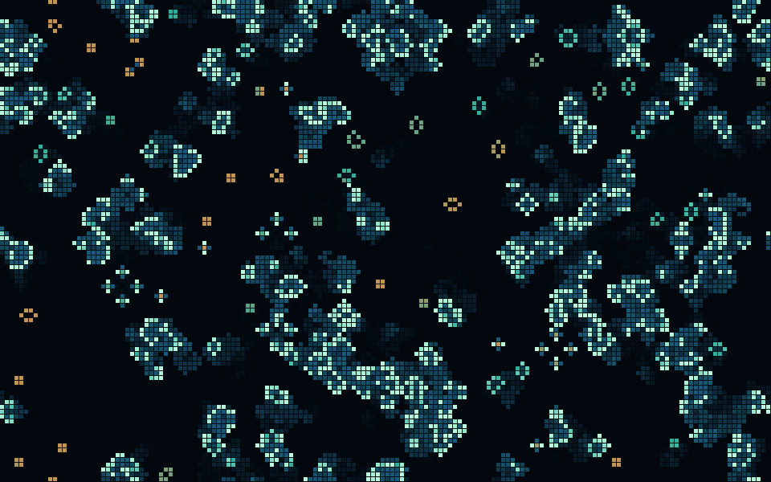
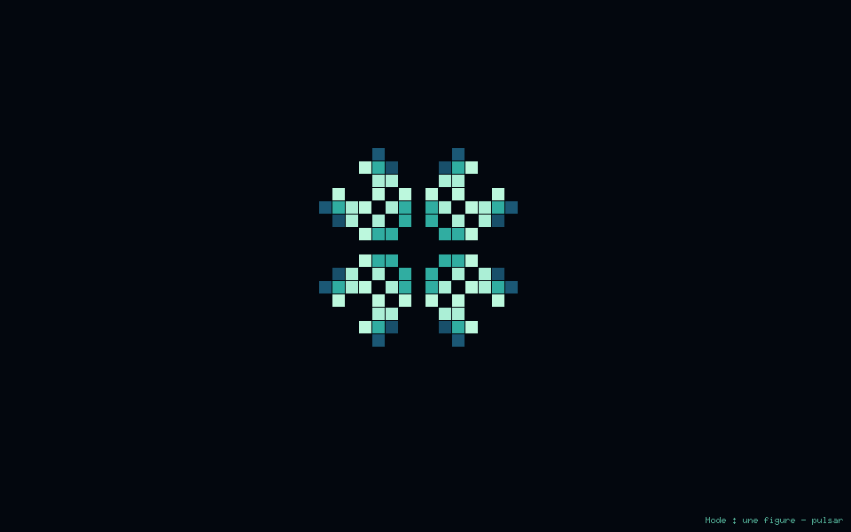
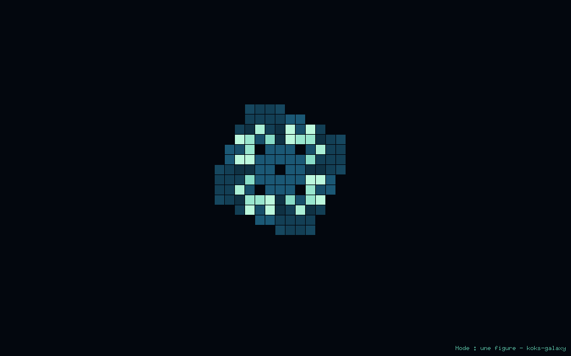

<p align="center"></p>

# Game of Life · cheap & beautiful

**810 small worlds. Room to grow. One tiny program.**

Mint births, midnight-blue trails, golden colonies. A tiny C99 + Xlib program
that turns Conway's Life into something worth leaving on your screen.

[Install](docs/INSTALL.md) · [Explore](docs/USAGE.md) · [Play a duel](docs/GAME.md) · [810 figures](FIGURES.md) · [Français](docs/README.fr.md)



## Make yourself a small universe

Install your platform's [build dependencies](docs/INSTALL.md#1-install-build-dependencies), then:

```sh
git clone https://github.com/mikaeldusenne/XScreenSaver_GameOfLife.git
cd XScreenSaver_GameOfLife
./install.sh
~/.local/bin/game-of-life
```

The installer adds a menu launcher, an icon, a manual and Bash completion
under `~/.local`.
No root access, background service or startup changes are made by the installer.
Once `~/.local/bin` is in your PATH, just type `game-of-life`.

```sh
game-of-life figure pulsar       # A perfect rhythm
game-of-life figure bunnies      # A tiny seed, a very long story
game-of-life mix                 # Let classic figures meet
game-of-life figures gun         # Find something new
game-of-life screensaver         # X11 wallpaper + saver after two idle minutes
game-of-life replay              # Revisit the last recorded wallpaper world
game-of-life doctor              # What can this session do?
game-of-life random --gpu --size 1 # Try the optional GPU engine, one pixel per cell
game-of-life fancy                # Warm embers and subtle rising flames (GPU)
```

**Left click → next. Right click → previous. Scroll → zoom at the pointer.**
Middle click restores the original view. In the idle saver, any key brings
you back to work and leaves the wallpaper alive. The 64-scene history replays
the same initial worlds. Controls and the current figure are labeled discreetly.
English and French captions follow the system locale, or `--lang en|fr`.

**Keep the worlds, not the frames.** Wallpaper mode saves a tiny recipe for each
initial world in `~/.local/state/game-of-life/history.tsv` (or `$XDG_STATE_HOME`).
`game-of-life replay 42` brings line 42 back to life, at its original grid size.
No per-frame disk writes. [History, replay and the format](docs/USAGE.md#keep-a-world).

<table>
<tr><td></td><td></td></tr>
<tr><td><b>Pulsar</b> · watch a rhythm</td><td><b>Kok's galaxy</b> · watch a rotation</td></tr>
</table>

## Play together

**Life Duel** turns the same figures into a two-player strategy game. Draft
your constructions, commit together, and watch 16 generations unfold. Hold
the central objectives to win; earn energy and unlock spaceships and glider guns.
New cells inherit the majority color of their parents. The background subtly
follows the balance between the mint and gold colonies.

Install the optional `libwebsockets` development package, then:

```sh
./install.sh
~/.local/bin/game-of-life game
```

Open **http://localhost:7681** and create a room. For another device on your LAN,
start with `game-of-life game --bind 0.0.0.0`, open the host's LAN address and
share the invitation link. The C server handles rules and synchronization;
players only need a browser. No GPU or X11 is needed for the game server.
Matches support reconnection and compact, downloadable replays.
[Installation, rules and server details](docs/GAME.md).

## Choose how the screensaver runs

There are two ways to use it as a screensaver in an **X11 desktop session**:

| | Built-in `screensaver` mode | XScreenSaver integration |
| --- | --- | --- |
| While you work | Animated wallpaper, paused when fully covered | Game of Life starts only when the saver activates |
| Activation | After two idle minutes by default | Delay set in XScreenSaver |
| Controls | Left/right click: next/previous; scroll: zoom; any key: return to work | XScreenSaver handles input and dismisses the animation |
| Session locking | No password lock | Optional locking managed by XScreenSaver |

**The built-in mode is the setup used on the development i3 machine.** It
raises the wallpaper above applications after two idle minutes, including
fullscreen windows. Returning to work leaves the wallpaper running behind them.
XScreenSaver is a separate, optional integration.

After installation, try the built-in mode with the default CPU engine:

```sh
~/.local/bin/game-of-life screensaver
```

To reproduce the development machine's **GPU, high-definition worlds and
classic mint/blue/gold colors**, install the [GPU dependencies](docs/GPU.md#requirements)
before running `./install.sh`, then:

```sh
~/.local/bin/game-of-life doctor --gpu
~/.local/bin/game-of-life screensaver --gpu --random-size 1 --classic
```

This needs an OpenGL 4.3 driver. Use `--random-size 2` on a 4K display;
`1` is suitable for Full HD. Single figures keep their automatic framing.
GPU cells become rounded when enlarged, including with scroll zoom.
Stop a foreground trial with Ctrl+C in its terminal before enabling autostart.

For **automatic startup**, follow the [systemd and i3 instructions](docs/INSTALL.md#i3-and-other-minimal-window-managers).
The supplied service uses the CPU by default. For the GPU setup above, replace
its `ExecStart` line with:

```ini
ExecStart=%h/.local/bin/game_of_life --wallpaper --alternate --idle 120 --gpu --random-size 1 --classic
```

For an animation that runs only during inactivity, with optional locking,
follow the [XScreenSaver setup](docs/INSTALL.md#xscreensaver).
Both integrations require an X11 desktop; Xwayland is not sufficient.

## Thoughtful defaults

- **Space to grow.** Single figures are centered with margins, with extra room
  for glider guns and expansive seeds.
- **Time to see it.** Still lifes, oscillators, producers and explosions get
  different observation budgets. Settled random worlds give way to fresh ones.
- **Quiet when hidden.** A fully covered wallpaper pauses. Rendering batches
  only changed cells in CPU mode, at 15 fps. Random worlds and figure mixes have a budget of
  256,000 cells: about four times the previous definition in Full HD.
- **One small executable.** Around 290 KB with GPU support on the development
  machine, including all 810 figures. No network access or runtime asset downloads.

**CPU by default, GPU when you choose.** `--gpu` computes and draws Life with
OpenGL 4.3. The original CPU/Xlib engine stays available with `--cpu`, including
builds without any OpenGL dependency. Both engines share the same figures,
palette, controls and replayable initial worlds. Check `game-of-life doctor --gpu`
before trying it. [GPU setup and tradeoffs](docs/GPU.md).

GPU cells have softly rounded corners from five pixels upwards, including
when zoomed in. Use `--square-cells` for sharp corners. Zoom changes only the
view: the same world keeps evolving, with the same simulation cost.

**A little fire.** `--fancy` adds cream-colored births, amber cells, cooling
embers and gently rising flames. It selects the GPU engine and works with
any scene, zoom or replay. Try `game-of-life figure pulsar --fancy`.
`--classic` restores the original palette and removes the flames.

The library includes 148 still lifes, 387 oscillators, 90 spaceships, 15 guns,
14 puffers, 5 rakes, 25 long-lived seeds and 126 other evolving patterns.
[Browse the catalogue](FIGURES.md), or search it from the terminal.

## Platforms

| Platform | What you get |
| --- | --- |
| Linux / X11 | Preview, wallpaper, interactive idle saver, XScreenSaver integration |
| BSD / X11 | Portable source build; desktop behavior still needs platform validation |
| macOS / XQuartz | X11 preview; Intel and Apple Silicon build configuration |
| Linux / Wayland | Preview through Xwayland |
| Windows / WSLg | Linux GUI preview on Windows |

Wallpaper and whole-session idle handling require an X11 desktop. XQuartz,
Xwayland and WSLg do not make this a native macOS, Wayland or Windows saver.
The built-in idle mode is not a lock screen. [Platform details and dependencies](docs/INSTALL.md).

The core remains deliberately small: CMake for portable builds and packaging,
or the original GNU Makefile for a renderer-only installation. libXss is optional
unless you want native idle detection. A standard XScreenSaver can manage idle
and locking instead. [Autostart and XScreenSaver setup](docs/INSTALL.md#start-with-your-session).

## Build, check, package

```sh
cmake -S . -B build -DBUILD_TESTING=ON
cmake --build build --parallel
ctest --test-dir build --output-on-failure
```

The existing checks compare 4,200 generations to an independent implementation,
verify all 810 pattern seeds and eight symmetries, and exercise adaptive timing
and framing. X11 behavior has also been exercised under Xvfb and i3, including
the real 120-second idle threshold, history replay, focus and hidden-window CPU
pause. See the [historical CPU benchmarks](bench/README.md) for measurements and
their limits; these are not electricity-consumption measurements.
The [latest performance notes](bench/PERFORMANCE.md) compare the optimized
neighbor calculation and X11 drawing separately, and discuss further options.
See the [denser-world measurements](bench/DENSE.md) for the 0.4 engine and CPU
usage as random worlds develop and settle. The [GPU measurements](bench/GPU.md)
compare the optional 0.5 engine on a real display.

CMake supports staging with `DESTDIR` and building native TGZ, DEB or RPM
packages via CPack. Builds and simulation checks pass on Arch, Debian, Fedora
and Alpine; the DEB and RPM have been installed in clean containers.
A [ready-to-enable CI recipe](ci/README.md) covers Linux
x86-64/ARM64, macOS Intel/Apple Silicon, and Alpine. It is provided as a template,
not an active workflow or a claim that every platform has been tested.
[Build and packaging details](docs/INSTALL.md#cmake-packaging-and-the-small-makefile).

## History & vibe coding

Development began in **2015**. The first commit was made in **2024**.
The first AI assistance arrived in **late October 2026**, beginning the
project's **“vibe coding”** chapter.

## License and pattern sources

The original permissive software notice is preserved in [LICENSE](LICENSE).
Pattern provenance, source RLE links and the scope of the catalogue are
documented in [FIGURES.md](FIGURES.md).
