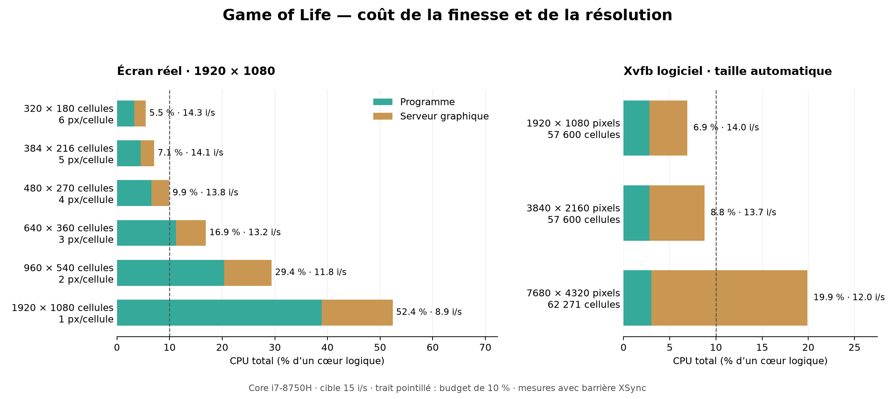

# Benchmark CPU — 26 octobre 2026

Sur l’écran réel **1920 × 1080**, la limite raisonnable à une cible de 15 images/s
est **480 × 270 cellules** (`-size 4`) : environ **10 % d’un cœur logique** pour
le programme et le serveur graphique ensemble. Le réglage **`-size 5`**,
soit **384 × 216 cellules**, garde une marge : environ **7 %**.

Pour la résolution d’affichage, **la 4K en taille automatique reste raisonnable**
dans les essais logiciels isolés. La 8K fonctionne, mais double approximativement
le coût total et descend à 12 images/s. La 4K et la 8K ont été mesurées sous Xvfb,
pas sur des moniteurs physiques de ces résolutions.



## Affichage réel : finesse de la grille

Core i7-8750H, écran X11 1920 × 1080, Xorg et i3. Les pourcentages sont ceux
d’**un cœur logique** : 100 % signifie un cœur occupé en permanence.
« Graphique » comprend Xorg et i3, y compris leur éventuelle activité étrangère
au screensaver. Le total n’est pas le CPU de toute la machine.

| Taille des cellules | Grille | Cellules | Programme | Graphique | Total | Images/s |
| --- | --- | ---: | ---: | ---: | ---: | ---: |
| Auto : 6 px | 320 × 180 | 57 600 | 3,3 % | 2,2 % | **5,5 %** | 14,3 |
| 5 px | 384 × 216 | 82 944 | 4,5 % | 2,6 % | **7,1 %** | 14,1 |
| 4 px | 480 × 270 | 129 600 | 6,5 % | 3,4 % | **9,9 %** | 13,8 |
| 3 px | 640 × 360 | 230 400 | 11,2 % | 5,7 % | **16,9 %** | 13,2 |
| 2 px | 960 × 540 | 518 400 | 20,4 % | 9,0 % | **29,4 %** | 11,8 |
| 1 px | 1920 × 1080 | 2 073 600 | 38,9 % | 13,5 % | **52,4 %** | 8,9 |

Les valeurs des répétitions sont moyennées en pondérant par leur durée.
`-size 4` varie de **9,5 à 10,8 %** : il est à la frontière du budget, avec peu
de marge. `-size 5` varie de **6,75 à 7,40 %** sur deux mondes différents.

```sh
./game_of_life -fullscreen -size 5 -fps 15  # Marge confortable
./game_of_life -fullscreen -size 4 -fps 15  # Finesse maximale autour de 10 %
```

## Résolution d’affichage : coût du rendu logiciel

Xvfb isolé, cible de 15 images/s, taille automatique. Le coût du serveur augmente
avec la surface à peindre même lorsque la grille reste de taille comparable.

| Affichage | Taille | Grille | Programme | Xvfb | Total | Images/s |
| --- | ---: | --- | ---: | ---: | ---: | ---: |
| Full HD : 1920 × 1080 | 6 px | 320 × 180 | 2,8 % | 4,1 % | **6,9 %** | 14,0 |
| 4K : 3840 × 2160 | 12 px | 320 × 180 | 2,8 % | 6,0 % | **8,8 %** | 13,7 |
| 8K : 7680 × 4320 | 23 px | 333 × 187 | 3,0 % | 16,9 % | **19,9 %** | 12,0 |

En 4K, augmenter la grille à 480 × 270 cellules (`-size 8`) porte déjà le total
à **14,8 %**, pour 13 images/s. La taille automatique est donc le bon choix
pour cette résolution avec ce rendu logiciel. La 4K automatique varie de
**8,25 à 9,80 %** sur les deux mesures.

Ces résultats fixent un compromis pour cette machine, cette cadence et cette
palette. Ils ne constituent pas une limite technique universelle, une mesure
du GPU ou une mesure de consommation électrique. Le critère retenu est un coût
proche de 10 % d’un cœur au maximum et au moins environ 90 % de la cadence cible.

## Méthode et contrôle de l’instrumentation

- Exécutions séquentielles, compilation `-O2`, aucune instrumentation mémoire.
- Trois secondes après lancement, puis dix secondes de mesure par cas.
- Confirmation des tailles 4 et 5 sur vingt secondes chacune, avec les graines
  42 et 2026, en inversant leur ordre. Confirmation de la 4K sur vingt secondes.
- CPU lu dans `/proc/PID/stat`, RAM résidente dans `/proc/PID/status`.
- La version de mesure ajoute une barrière **`XSync` après chaque dessin** et
  enregistre l’horodatage. La cadence compte donc des images traitées par le
  serveur X11, pas seulement une file de commandes qui pourrait s’allonger.
  Elle ne mesure pas les rafraîchissements physiques du moniteur.
- Cette barrière et le compteur ne sont **pas inclus dans le binaire normal**.
  Le contrôle de vingt secondes avec le binaire normal, en Full HD à `-size 5`,
  donne **4,30 % programme + 2,45 % graphique = 6,75 %** : le même total arrondi
  que la mesure instrumentée avec la même graine.
- Les relevés d’activité graphique avant chaque lancement sont conservés dans
  les données, sans les soustraire : le bureau exposé et le bureau recouvert par
  l’aperçu n’ont pas forcément la même activité.

Le processus utilise environ **3,3 Mo de RAM** au réglage recommandé. Cette
valeur n’inclut pas la mémoire du serveur graphique.

## Reproduire

Les mesures utilisent Python standard, un compilateur C, les en-têtes Xlib et
Xvfb. Le mode bureau nécessite aussi `xdotool`. Matplotlib sert uniquement à
exporter le graphique.

Depuis la racine du dépôt :

```sh
make
python3 bench/run.py --output /tmp/life-xvfb.json
python3 bench/run.py --cases 3840x2160:0 --seconds 20 --seed 2026 \
  --output /tmp/life-4k-confirm.json
```

Pour l’affichage réel, relever les PID de Xorg et du gestionnaire/compositeur,
puis les passer à `--graphics-pids`. La fenêtre est mise en plein écran ; une
touche la ferme et interrompt la mesure. Les dimensions réelles sont vérifiées
avant le relevé. Exemple avec les PID utilisés lors de ce benchmark :

```sh
python3 bench/run.py --desktop --graphics-pids 3283,3345 \
  --cases 1920x1080:5,1920x1080:4 --seconds 20 --baseline 2 --seed 42 \
  --output /tmp/life-desktop.json
```

Ajouter `--no-frame-probe` pour mesurer le binaire normal sans compteur de
cadence. `python3 bench/plot.py` régénère les graphiques PNG et SVG à partir des
résultats enregistrés dans ce dossier.

Les six fichiers `results-*.json` contiennent les **22 exécutions**, dont le
contrôle sans sonde. `machine.json` conserve les versions et les empreintes des
sources et du binaire. Aucun réglage du screensaver n’a été modifié par le bench.
